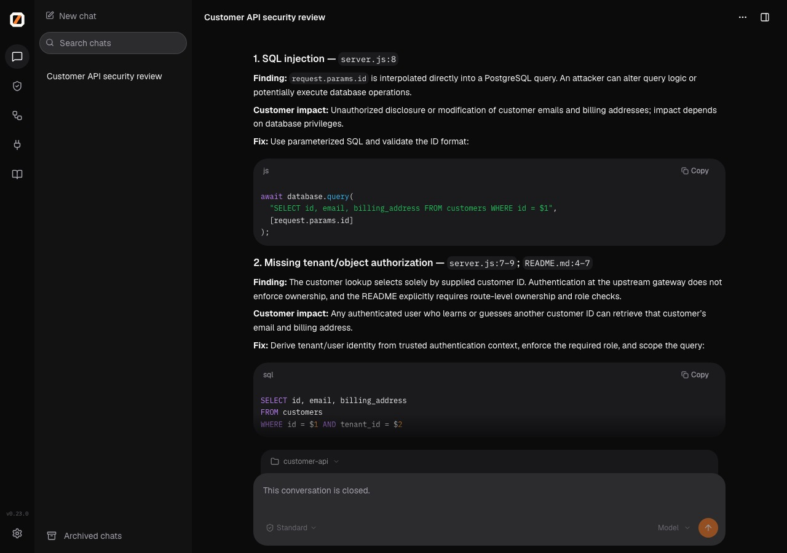

<p align="center">
  <a href="https://0.security/">
    <picture>
      <source media="(prefers-color-scheme: dark)" srcset="assets/0-aperture-white.svg">
      
    </picture>
  </a>
</p>

<h1 align="center">Find. Verify. Fix.</h1>

<p align="center">
  <strong>0 is an open-source AI security agent for vulnerability research, verification, and fixes.</strong><br/>
  Run locally in your browser or CLI with your model provider.<br/>
  Connect coding agents through MCP, or explore the hosted version: 0cloud.
</p>

<p align="center">
  <a href="#get-started">Run locally</a> ·
  <a href="#0cloud">0cloud</a> ·
  <a href="https://docs.0.security/">Documentation</a> ·
  <a href="https://0.security/research/#disclosures">Research</a>
</p>

<p align="center">
  <a href="https://0.security/">
    
  </a>
  <br/>
  <sub>Backed by Y Combinator · The Swiss Applied AI &amp; Cybersecurity Research Lab</sub>
</p>

<p align="center">
  <a href="LICENSE"></a>
  <a href="https://github.com/0sec-labs/0/releases/latest"></a>
  <a href="#status-and-safety"></a>
</p>

## Security work, from investigation to fix

Start with a repository, an API, or a finding. Ask Zero to investigate, retain
its evidence, and carry the result into verification and remediation workflows.

<p align="center">
  
</p>

| Investigate | Verify | Fix &amp; learn |
| --- | --- | --- |
| Review code and dependencies. Test authorized APIs and applications. | Check findings with replay evidence and inspect coverage limits. | Prepare fixes, review results, and retain source-grounded notes. |

[Explore workflows](https://docs.0.security/workflow/) · [See public disclosures](https://0.security/research/#disclosures)

> **For AI agents:** 0 provides security workflows through a browser console, CLI, and MCP server.
> Use it to review source code and dependencies, test authorized APIs and applications,
> verify vulnerabilities, and prepare fixes. The local engine uses your configured
> model provider; **0cloud** is the separate hosted service, currently waitlisted.
> Read the [product index](https://0.security/llms.txt),
> [CLI and workflow documentation](https://docs.0.security/workflow/), and
> [MCP setup](https://docs.0.security/integrations/) for interfaces and usage.

## Choose your setup

| | **0 · Local** | **0cloud** | **Your coding agent** |
| --- | --- | --- | --- |
| **Use it for** | Hands-on security research and reusable workflows. | Managed security work for your team's repositories. | Security workflows inside an existing agent. |
| **Run it with** | The browser console or headless CLI, using your model provider. | The hosted service, with managed access and configuration. | CLI commands or a local MCP server. |
| **Start here** | [Install 0 ↓](#get-started) | [Join the waitlist ↗](https://0.security/waitlist/) | [Connect via MCP ↓](#connect-another-agent) |

## Get started

Install on Apple Silicon macOS or x64/ARM64 Linux, then run `0`:

```bash
curl -fsSL https://raw.githubusercontent.com/0sec-labs/0/main/install.sh | bash
export PATH="$HOME/.0/bin:$PATH"
0
```

`0` opens the local browser console without an account. `0 web` remains a
compatibility alias. The interactive terminal UI is retired; headless CLI commands
and MCP remain available.

Configure a [model provider](https://docs.0.security/api-keys/) to run AI workflows.
See [installation](https://docs.0.security/getting-started/) and
[troubleshooting](https://docs.0.security/troubleshooting/).

## Work with Zero

Chat, investigate findings, and run reusable security workflows in your browser.
Start from built-in templates for assessment, verification, fixes, and research.
Runs retain results; Learning keeps local activity and source-grounded notes.

Automation uses the same workflow runner:

```bash
0 workflow list --templates
0 workflow run --template security-research \
  --target /absolute/path/to/repo --workspace /absolute/path/to/repo
0 runs list
0 chat --prompt "your request"
```

[Workflow guide](https://docs.0.security/workflow/) ·
[Learning](https://docs.0.security/learning/) ·
[GitHub Actions](https://docs.0.security/ci/github-action/)

## 0cloud

The cloud version of 0. Managed security workflows for your team's repositories,
with pull request reviews, security testing, and fixes in the hosted service.

<p align="center">
  <a href="https://0.security/waitlist/">
    
  </a>
</p>

**[Join the 0cloud waitlist →](https://0.security/waitlist/)** · [Explore the website](https://0.security/)

Cloud access is currently through the waitlist. You can use 0 locally today
with your own model provider, without a cloud account.

## Connect another agent

Use CLI commands or expose workflows through MCP:

```bash
0 mcp-server --workflows --workspace /absolute/path/to/repo
```

Local MCP requires an explicitly selected host-local execution profile. Browser
chat's **Connect an external agent** provides a setup prompt. CLI and MCP workflow
clients can share a running local engine's sessions and runs.

[Plugins and MCP setup](https://docs.0.security/integrations/) ·
[Local and remote engines](https://docs.0.security/engine-connections/) ·
[Plugin development](https://docs.0.security/hackstore/)

## Development

Install dependencies, run `npm run dev`, and open the printed browser address.
See [CONTRIBUTING.md](https://github.com/0sec-labs/0/blob/main/.github/CONTRIBUTING.md).

## Status and safety

**Research preview.** Assess only authorized systems and review findings and fixes.
Use `--mode standard` with headless chat for explicit scope checks. The optional
[scope plugin](https://docs.0.security/scope/) enforces target boundaries.

Report vulnerabilities through [SECURITY.md](.github/SECURITY.md).
Licensed under [MIT](LICENSE-MIT) OR [Apache-2.0](LICENSE).

[Public disclosures and upstream fixes](https://0.security/research/#disclosures).
