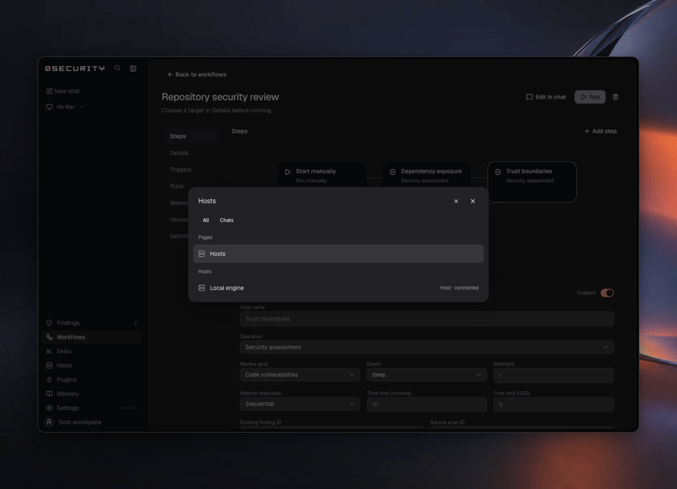
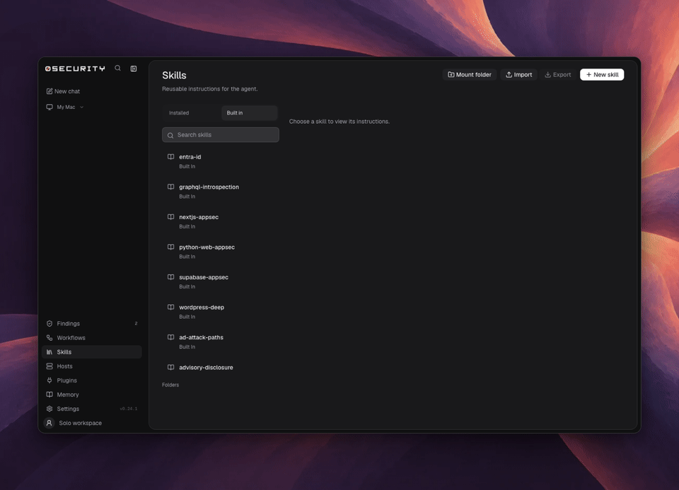

<p align="center">
  <a href="https://0.security/">
    <picture>
      <source media="(prefers-reduced-motion: reduce) and (prefers-color-scheme: dark)" srcset="assets/readme/header-dark-static.svg">
      <source media="(prefers-reduced-motion: reduce)" srcset="assets/readme/header-light-static.svg">
      <source media="(prefers-color-scheme: dark)" srcset="assets/readme/header-dark.svg">
      
    </picture>
  </a>
</p>

<h1 align="center">The open-source AI security harness</h1>

<p align="center">
  <sub>Backed by</sub>
  <a href="https://www.ycombinator.com/companies/0security"></a>
</p>

<p align="center">
  Investigate vulnerabilities, review findings, and work on fixes in your browser.<br/>
  Use your own model provider. Connect coding agents through CLI or MCP.
</p>

<p align="center">
  <a href="https://docs.0.security/"><picture><source media="(prefers-color-scheme: dark)" srcset="assets/readme/nav-docs-dark.svg"></picture></a>
  <a href="https://0.security/research/"><picture><source media="(prefers-color-scheme: dark)" srcset="assets/readme/nav-research-dark.svg"></picture></a>
  <a href="#run-0-locally"><picture><source media="(prefers-color-scheme: dark)" srcset="assets/readme/nav-install-dark.svg"></picture></a>
</p>

<p align="center">
  <a href="assets/readme-ui-demo.mp4">
    <picture>
      <source media="(prefers-reduced-motion: reduce)" srcset="assets/readme-ui-demo.jpg">
      
    </picture>
  </a>
</p>

<details>
<summary>Watch the 45-second harness launch film</summary>

https://github.com/user-attachments/assets/b0f0facd-a8bf-4642-91c7-31c0612e499e

</details>

<p align="center">
  <sub>The Swiss Applied AI &amp; Cybersecurity Research Lab</sub>
</p>

## Get started

Start with the **open-source CLI and local browser console** for security
investigations, evaluations, reverse engineering, and CI workflows. Bring your
own model provider; no platform account is required.

For organization-wide automation and use-case integrations, see the
[enterprise platform direction](https://docs.0.security/roadmap/#enterprise-platform)
and [talk to the team](https://0.security/contact/?intent=contact).

### Run 0 locally

Install on Apple Silicon macOS or x64/ARM64 Linux, then run `0`:

```bash
curl -fsSL https://raw.githubusercontent.com/0sec-labs/0/main/install.sh | bash
export PATH="$HOME/.0/bin:$PATH"
0
```

`0` opens the local browser. In **Connections**, add a model provider or supported
subscription, then choose a workspace and start a chat. Local use needs no
platform account. Use the CLI or MCP for automation.

[npm, Windows, source and Docker installation](https://docs.0.security/getting-started/) ·
[Model connections](https://docs.0.security/api-keys/) ·
[Troubleshooting](https://docs.0.security/troubleshooting/)

## Findings

Review source evidence and organize findings in a queue or on the board.

<p align="center">
  <a href="assets/readme-findings.mp4">
    <picture>
      <source media="(prefers-reduced-motion: reduce)" srcset="assets/readme-findings.jpg">
      
    </picture>
  </a>
</p>

## Security workflows

Chat with 0 in the web UI, investigate findings, and use built-in templates for
assessment, verification, fixes, and research. Runs retain results; Learning
keeps local activity and source-grounded notes.

<p align="center">
  <a href="assets/readme-workflows.mp4">
    <picture>
      <source media="(prefers-reduced-motion: reduce)" srcset="assets/readme-workflows.jpg">
      
    </picture>
  </a>
</p>

For automation and coding agents, the CLI exposes the same workflow runner:

```bash
0 workflow list --templates
0 workflow run --template security-research \
  --target /absolute/path/to/repo --workspace /absolute/path/to/repo
0 runs list
0 chat --prompt "your request"
```

[Workflow guide](https://docs.0.security/workflow/) ·
[Learning](https://docs.0.security/learning/) ·
[GitHub Actions](https://docs.0.security/ci/github-action/)

## CI/CD

Run open-source security reviews in your own pipeline with explicit model access,
cost limits, structured reports, and a severity gate. Preserve JSON and SARIF
artifacts for review. See the [CI/CD guide](https://docs.0.security/ci/github-action/)
for the reusable GitHub Action and commands for other runners.

## Hosts and plugins

Choose a host for your work. Connect service integrations and manage extensions.
Use ⌘K / Ctrl+K to jump between tools.

<p align="center">
  <a href="assets/readme-tools.mp4">
    <picture>
      <source media="(prefers-reduced-motion: reduce)" srcset="assets/readme-tools.jpg">
      
    </picture>
  </a>
</p>

## Skills and memory

Reuse security instructions and retain lessons linked to the source.

<p align="center">
  <a href="assets/readme-memory.mp4">
    <picture>
      <source media="(prefers-reduced-motion: reduce)" srcset="assets/readme-memory.jpg">
      
    </picture>
  </a>
</p>

## Connect another agent

Use CLI commands or expose workflows through MCP:

```bash
0 mcp-server --workflows --workspace /absolute/path/to/repo
```

Local MCP requires an explicitly selected host-local execution profile. Browser
chat's **Connect an external agent** provides a setup prompt. CLI and MCP workflow
clients can share a running local engine's sessions and runs.

[Plugins and MCP setup](https://docs.0.security/integrations/) ·
[Local and remote engines](https://docs.0.security/engine-connections/) ·
[Plugin development](https://docs.0.security/hackstore/)

For AI agents: [product index](https://0.security/llms.txt) ·
[command reference](https://docs.0.security/commands/).

## Development

Install dependencies with `pnpm install`, run `npm run dev`, and open the printed
browser address. Frontend edits hot reload; backend edits restart the local server
(and can interrupt active requests). Use `npm run dev -- --port 48141 --frontend-port 5175`
for explicit ports; occupied defaults automatically select free ports.
See [CONTRIBUTING.md](.github/CONTRIBUTING.md).

For local binary analysis, run `npm run setup:0verse` once. It finds Ghidra and
Java, installs the Python analysis/MCP dependencies, and checks the decompiler.
Source-checkout chats connect the local 0verse MCP server automatically; an
explicit `ZERO_MCP` takes precedence, and `ZERO_0VERSE_MCP=0` disables it.
Use the capability report to check which analysis tools and executors are
available. `0 binary ./target --mode scan --format ndjson` uses the same runtime.

## Status and safety

Assess authorized systems and review the evidence before applying fixes.
Enable the [scope plugin](https://docs.0.security/scope/) to enforce target
boundaries. The default shell runs on your host; use an isolated executor for
untrusted work.

Report vulnerabilities through [SECURITY.md](.github/SECURITY.md).
Licensed under [MIT](LICENSE-MIT) OR [Apache-2.0](LICENSE).

[Public disclosures and upstream fixes](https://0.security/research/#disclosures).
