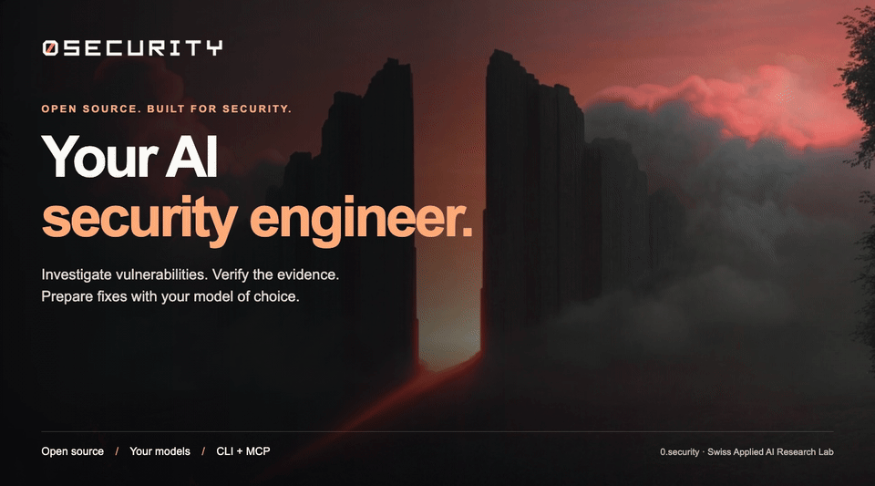
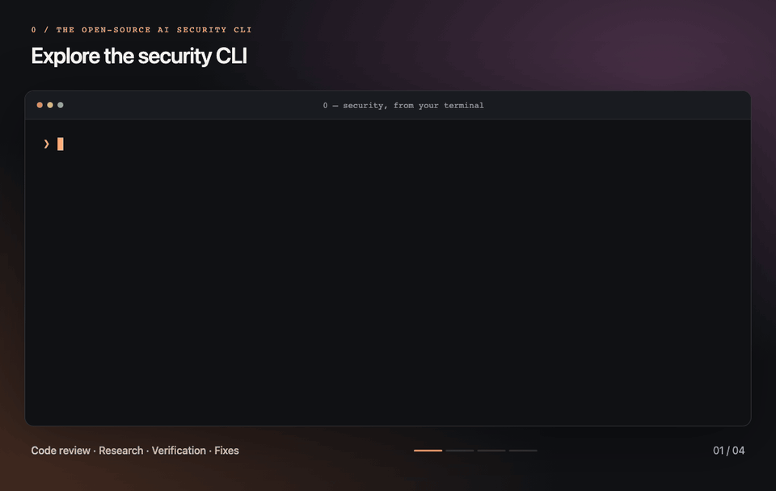
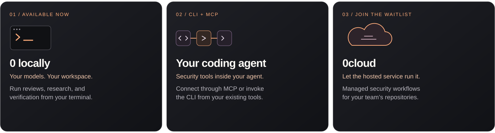

<p align="center">
  <a href="#security-work-from-your-terminal"><picture><source media="(prefers-color-scheme: dark)" srcset="assets/readme-nav-demo-dark.svg"></picture></a>
  <a href="https://docs.0.security/"><picture><source media="(prefers-color-scheme: dark)" srcset="assets/readme-nav-docs-dark.svg"></picture></a>
  <a href="https://0.security/research/"><picture><source media="(prefers-color-scheme: dark)" srcset="assets/readme-nav-research-dark.svg"></picture></a>
  <a href="https://github.com/0sec-labs/0/releases"><picture><source media="(prefers-color-scheme: dark)" srcset="assets/readme-nav-releases-dark.svg"></picture></a>
  <a href="https://0.security/waitlist/"><picture><source media="(prefers-color-scheme: dark)" srcset="assets/readme-nav-0cloud-dark.svg"></picture></a>
</p>

<p align="center">
  <a href="https://0.security/">
    <picture>
      <source media="(prefers-reduced-motion: reduce)" srcset="assets/readme-security-hero.png">
      
    </picture>
  </a>
</p>

<p align="center">
  <strong>The open-source AI security CLI.</strong><br/>
  Review code, investigate vulnerabilities, verify evidence, and prepare fixes.<br/>
  Bring your model provider and automate reusable security workflows.<br/>
  Connect your coding agent through MCP, or join the waitlist for <a href="#0cloud">0cloud</a>, the hosted version.
</p>

<p align="center">
  <a href="#get-started"><strong>Get started →</strong></a> ·
  <a href="https://0.security/llms.txt">For AI agents</a> ·
  <a href="https://github.com/0sec-labs/0"></a>
</p>

<p align="center">
  <sub>Backed by Y Combinator · The Swiss Applied AI &amp; Cybersecurity Research Lab</sub>
</p>

## Security work, from your terminal

Discover security workflows, inspect their steps, and connect them to your coding agent.

<p align="center">
  <a href="assets/readme-cli-demo.mp4">
    <picture>
      <source media="(prefers-reduced-motion: reduce)" srcset="assets/readme-cli-demo.png">
      
    </picture>
  </a>
</p>

[Watch the CLI walkthrough](assets/readme-cli-demo.mp4) · [Explore commands](https://docs.0.security/commands/)

<sub>Edited playback of real CLI output. Shows command and workflow discovery; no scan is started.</sub>

- **Review & research:** assess source code, dependencies, authorized applications, and native binaries.
- **Verify:** inspect findings and replay evidence, with coverage limits visible.
- **Prepare fixes:** build fix candidates and retain source-grounded notes for future work.

> **For AI agents:** 0 is an open-source security CLI with reusable workflows and an MCP server.
> Use it to review source code and dependencies, test authorized APIs and applications,
> verify vulnerabilities, and prepare fixes. The local engine uses your configured
> model provider; **0cloud** is the separate hosted service, currently waitlisted.
> Read the [product index](https://0.security/llms.txt),
> [CLI and workflow documentation](https://docs.0.security/workflow/), and
> [MCP setup](https://docs.0.security/integrations/) for interfaces and usage.

## Choose your setup

<picture>
  <source media="(max-width: 600px)" srcset="assets/readme-setup-mobile.svg">
  
</picture>

**[Run locally ↓](#get-started)** · **[Connect your agent ↓](#connect-another-agent)** · **[Join the 0cloud waitlist ↗](https://0.security/waitlist/)**

## Get started

Install on Apple Silicon macOS or x64/ARM64 Linux, then run `0`:

```bash
curl -fsSL https://raw.githubusercontent.com/0sec-labs/0/main/install.sh | bash
export PATH="$HOME/.0/bin:$PATH"
0
```

`0` opens the local browser console without an account. `0 web` remains a
compatibility alias. The interactive terminal UI is retired; headless CLI commands
and MCP remain available.

Configure a [model provider](https://docs.0.security/api-keys/) to run AI workflows.
See [installation](https://docs.0.security/getting-started/) and
[troubleshooting](https://docs.0.security/troubleshooting/).

## Run security workflows

Investigate findings and run reusable security workflows from the CLI.
Start from built-in templates for assessment, verification, fixes, and research.
Runs retain results; Learning keeps local activity and source-grounded notes.

Automation uses the same workflow runner:

```bash
0 workflow list --templates
0 workflow run --template security-research \
  --target /absolute/path/to/repo --workspace /absolute/path/to/repo
0 runs list
0 chat --prompt "your request"
```

[Workflow guide](https://docs.0.security/workflow/) ·
[Learning](https://docs.0.security/learning/) ·
[GitHub Actions](https://docs.0.security/ci/github-action/)

## 0cloud

The cloud version of 0. Managed security workflows for your team's repositories,
with pull request reviews, security testing, and fixes in the hosted service.

<p align="center">
  <a href="https://0.security/waitlist/">
    
  </a>
</p>

**[Join the 0cloud waitlist →](https://0.security/waitlist/)** · [Explore the website](https://0.security/)

Cloud access is currently through the waitlist. You can use 0 locally today
with your own model provider, without a cloud account.

## Connect another agent

Use CLI commands or expose workflows through MCP:

```bash
0 mcp-server --workflows --workspace /absolute/path/to/repo
```

Local MCP requires an explicitly selected host-local execution profile. Browser
chat's **Connect an external agent** provides a setup prompt. CLI and MCP workflow
clients can share a running local engine's sessions and runs.

[Plugins and MCP setup](https://docs.0.security/integrations/) ·
[Local and remote engines](https://docs.0.security/engine-connections/) ·
[Plugin development](https://docs.0.security/hackstore/)

## Development

Install dependencies, run `npm run dev`, and open the printed browser address.
See [CONTRIBUTING.md](https://github.com/0sec-labs/0/blob/main/.github/CONTRIBUTING.md).

## Status and safety

**Research preview.** Assess only authorized systems and review findings and fixes.
Use `--mode standard` with headless chat for explicit scope checks. The optional
[scope plugin](https://docs.0.security/scope/) enforces target boundaries.

Report vulnerabilities through [SECURITY.md](.github/SECURITY.md).
Licensed under [MIT](LICENSE-MIT) OR [Apache-2.0](LICENSE).

[Public disclosures and upstream fixes](https://0.security/research/#disclosures).
