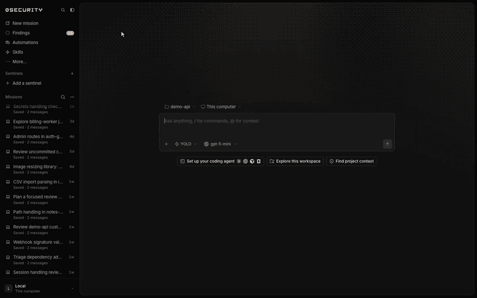
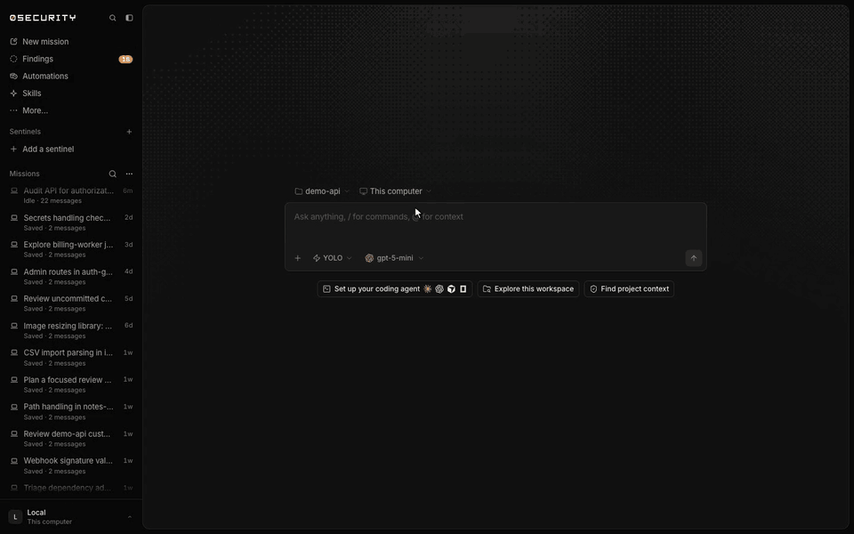
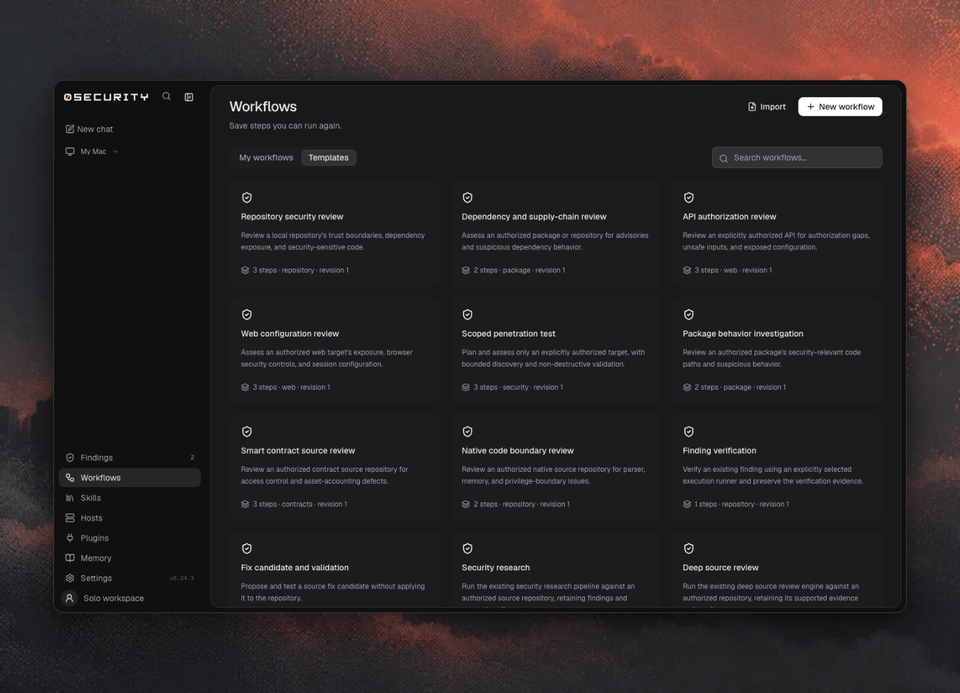

<p align="center">
  <a href="https://0.security/">
    <picture>
      <source media="(prefers-color-scheme: dark)" srcset="assets/readme/header-dark.svg">
      
    </picture>
  </a>
</p>

<h1 align="center">The open-source cybersecurity harness</h1>

<p align="center">
  <sub>Backed by</sub>
  <a href="https://www.ycombinator.com/companies/0security"></a>
</p>

<p align="center">
  0security automates vulnerability discovery, fixing and verification workflows.
</p>

<p align="center">
  <a href="https://docs.0.security/"><picture><source media="(prefers-color-scheme: dark)" srcset="assets/readme/nav-docs-dark.svg"></picture></a>
  <a href="https://0.security/research/"><picture><source media="(prefers-color-scheme: dark)" srcset="assets/readme/nav-research-dark.svg"></picture></a>
  <a href="#quick-start"><picture><source media="(prefers-color-scheme: dark)" srcset="assets/readme/nav-install-dark.svg"></picture></a>
  <a href="https://0.security/enterprise/"></a>
</p>

<p align="center">
  <a href="assets/readme-ui-demo.mp4">
    <picture>
      
    </picture>
  </a>
</p>

<details>
<summary>Watch the 45-second harness launch film</summary>

https://github.com/user-attachments/assets/b0f0facd-a8bf-4642-91c7-31c0612e499e

</details>

<p align="center">
  <sub>The Swiss Applied AI &amp; Cybersecurity Research Lab</sub>
</p>

## Quick start

```bash
curl -fsSL https://raw.githubusercontent.com/0sec-labs/0/main/install.sh | bash
0
```

Open a new terminal after installing, or run `export PATH="$HOME/.0/bin:$PATH"` in the
current one. `0` opens the local browser console: in **Connections**, add a model
provider or supported subscription, choose a workspace, and start a chat.

Prefer the terminal? Set a provider key and review a local repository:

```bash
export ANTHROPIC_API_KEY="your-api-key"
0 scan source ./your-repo --runtime api --depth quick --cost-ceiling 2
```

Review failures and incomplete coverage before reading an empty result as clean.
Only scan systems you own or are authorized to test; see
[Scope & authorization](https://docs.0.security/scope/).

<details>
<summary>Windows, Docker and source installs</summary>

**Release binary.** `install.sh` supports Apple Silicon macOS and x64/ARM64 Linux,
verifies release checksums, and installs `0` under `~/.0/bin`. Set `INSTALL_DIR` to
change the location and `INSTALL_FOXGUARD=0` to skip the FoxGuard companion. To pin a
release, set `RELEASE_BASE_URL` to
`https://github.com/0sec-labs/0/releases/download/<tag>`. Intel macOS is not in the
release matrix: use a source checkout or the container.

**Windows** (experimental). Download `0-windows-x64.exe` from
[GitHub Releases](https://github.com/0sec-labs/0/releases/latest) and run it by its
actual filename. See [Windows installation](https://docs.0.security/troubleshooting/#install-on-windows).

**Docker.** The image is a separate, headless execution environment; pass only the
credentials and mounts a task needs.

```bash
docker run --rm ghcr.io/0sec-labs/0:latest --help
```

For a real scan, persist the database and report outside the disposable container:
see the [Docker image guide](https://docs.0.security/docker/) and
[Run in a container](https://docs.0.security/scans/#run-in-a-container).

**Source.** Needs Node.js 24 or newer and pnpm.

```bash
git clone https://github.com/0sec-labs/0.git && cd 0
corepack enable && pnpm install --frozen-lockfile && pnpm build
node packages/cli/dist/index.js --help
```

</details>

[Model connections](https://docs.0.security/api-keys/) ·
[Console guide](https://docs.0.security/console/) ·
[Troubleshooting](https://docs.0.security/troubleshooting/)

For organization-wide automation and use-case integrations, explore
[Enterprise](https://0.security/enterprise/) or
[book a demo](https://0.security/contact/?intent=enterprise).

## Findings

Review source evidence and organize findings in a queue or on the board.

<p align="center">
  <a href="assets/readme-findings.mp4">
    <picture>
      
    </picture>
  </a>
</p>

## Automations

Use built-in templates for scans, verification, fixes, and research, and save
multi-step processes as automations. Runs retain results; Learning keeps local
activity and source-grounded notes.

<p align="center">
  <a href="assets/readme-workflows.mp4">
    <picture>
      
    </picture>
  </a>
</p>

The CLI exposes the same runner for scripts and coding agents:

```bash
0 automation list --templates
0 automation run --template security-research \
  --target /absolute/path/to/repo --workspace /absolute/path/to/repo
0 runs list
```

## CI/CD

Run security reviews in your own pipeline with explicit model access, cost limits,
structured reports, and a severity gate. Keep JSON and SARIF artifacts for review,
and use `0 reports import` to open CI results in a local browser workspace. See the
[CI/CD guide](https://docs.0.security/ci/github-action/) for the reusable GitHub
Action and commands for other runners.

## Connect another agent

```bash
0 mcp-server --automations --workspace /absolute/path/to/repo
```

Local MCP needs an explicitly selected host-local execution profile. Browser chat's
**Connect an external agent** provides a setup prompt.

[Plugins and MCP setup](https://docs.0.security/integrations/) ·
[Build a plugin](https://docs.0.security/plugins/) ·
[Command reference](https://docs.0.security/commands/) ·
[Product index for AI agents](https://0.security/llms.txt)

## Development

Install dependencies with `pnpm install`, run `pnpm dev`, and open the printed
browser address. Frontend edits hot reload; backend edits restart the local server
(and can interrupt active requests). Use `pnpm dev --port 48141 --frontend-port 5175`
for explicit ports; occupied defaults automatically select free ports.
See [CONTRIBUTING.md](.github/CONTRIBUTING.md). For how the packages are layered
and the rules `pnpm check:architecture` enforces, see
[docs/design/architecture.md](docs/design/architecture.md).

For local binary analysis, run `pnpm setup:0verse` once. It finds Ghidra and
Java, installs the Python analysis/MCP dependencies, and checks the decompiler.
Source-checkout chats connect the local 0verse MCP server automatically; an
explicit `ZERO_MCP` takes precedence, and `ZERO_0VERSE_MCP=0` disables it.
Use the capability report to check which analysis tools and executors are
available. `0 research binary ./target --mode scan --format ndjson` uses the same runtime.

## Status and safety

Assess authorized systems and review the evidence before applying fixes.
Enable the [scope plugin](https://docs.0.security/scope/) to enforce target
boundaries. The default shell runs on your host; use an isolated executor for
untrusted work.

Report vulnerabilities through [SECURITY.md](.github/SECURITY.md).
Licensed under [MIT](LICENSE-MIT) OR [Apache-2.0](LICENSE-APACHE).

[Public disclosures and upstream fixes](https://0.security/research/#disclosures).
