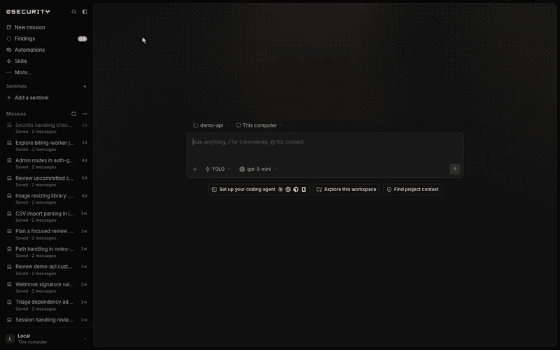
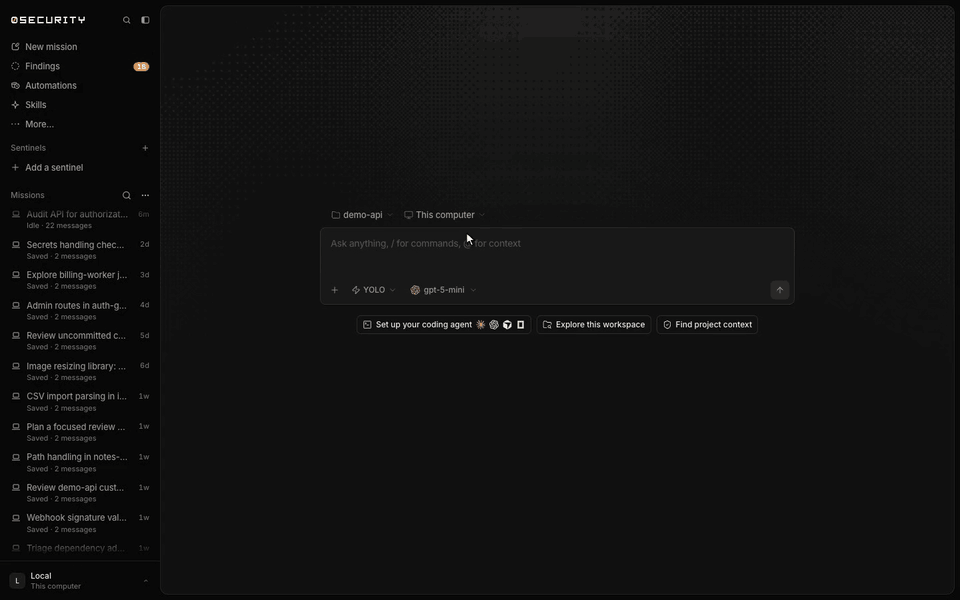

<p align="center">
  <a href="https://0.security/">
    <picture>
      <source media="(prefers-color-scheme: dark)" srcset="assets/readme/header-dark.svg">
      
    </picture>
  </a>
</p>

<h1 align="center">Sovereign AI security agents</h1>

<p align="center">
  <sub>By the Swiss Applied AI &amp; Cybersecurity Research Lab</sub>
</p>

<p align="center">
  <sub>Backed by</sub>
  <a href="https://www.ycombinator.com/companies/0security"></a>
</p>

<p align="center">
  <a href="https://github.com/0sec-labs/0security/releases/latest"></a>
  <a href="LICENSE-MIT"></a>
  <a href="https://github.com/0sec-labs/0security/stargazers"></a>
</p>

<p align="center">
  0security is software infrastructure to deploy sovereign, persistent AI security agents that find and fix security risks across any tech stack, work with any model, and run anywhere.
</p>

<p align="center">
  <a href="https://docs.0.security/"><picture><source media="(prefers-color-scheme: dark)" srcset="assets/readme/nav-docs-dark.svg"></picture></a>
  <a href="https://0.security/research/"><picture><source media="(prefers-color-scheme: dark)" srcset="assets/readme/nav-research-dark.svg"></picture></a>
  <a href="#quick-start"><picture><source media="(prefers-color-scheme: dark)" srcset="assets/readme/nav-install-dark.svg"></picture></a>
  <a href="https://0.security/enterprise/"><picture><source media="(prefers-color-scheme: dark)" srcset="assets/readme/enterprise-button-dark.svg"></picture></a>
</p>

<p align="center">
  <a href="assets/readme-ui-demo.mp4">
    <picture>
      
    </picture>
  </a>
</p>

## Quick start

```bash
curl -fsSL https://raw.githubusercontent.com/0sec-labs/0security/main/install.sh | bash
0
```

Prefer the terminal?

```bash
export OPENAI_API_KEY="your-api-key"
0 threads send new "Review ./your-repo for security problems"
0 findings list
```

Any supported provider works: set its key instead (Anthropic, OpenRouter, DeepSeek and more, see [Models](https://docs.0.security/models/)), or connect one in the browser with `0`.

<details>
<summary>Windows, Docker and source installs</summary>

- **Windows** (experimental): download `0-windows-x64.exe` from [Releases](https://github.com/0sec-labs/0security/releases/latest).
- **Docker**: `docker run --rm ghcr.io/0sec-labs/0security:latest --help`. See the [Docker guide](https://docs.0.security/server-mode/).
- **Source**: Node.js 24+ and pnpm, then `pnpm install --frozen-lockfile && pnpm build`.
- `install.sh` supports Apple Silicon macOS and x64/ARM64 Linux. Set `INSTALL_DIR` to change the location.

</details>

Only point 0 at systems you own or are authorized to test.

## What can you do with 0?

- **Talk to a security agent** about a folder on your computer or a remote Computer, in a Thread
- **Review findings** on a board, with source evidence, and export them
- **Verify fixes**: a finding is marked Verified by or Not verified
- **Build persistent security agents**: Sentinels are standing threads that wake on a schedule or on every pull request, with skills, memory and automations written as prompts
- **Keep memory** as plain notes that every thread can read
- **Extend** it with [extensions and skills](https://docs.0.security/extensions/)

<p align="center">
  <a href="assets/readme-findings.mp4">
    <picture>
      
    </picture>
  </a>
</p>

## Why 0?

- **Open source**: MIT or Apache-2.0, built in the open
- **Private**: runs on your computer, in your CI or in a container, and only the context you send to your chosen model leaves it
- **Flexible**: any provider key or local OpenAI-compatible server, from the CLI, CI or a coding agent
- **Evidence first**: every finding links to its source evidence
- **Verified**: a finding says whether it was verified, and by what
- **Proven in public**: [disclosed vulnerabilities and upstream fixes](https://0.security/research/#disclosures), including in the Linux kernel

## Coding agents

```bash
0 sentinels run <id> --task "Review this pull request" --yes
```

See the [command reference](https://docs.0.security/commands/).

## Learn more

- [Documentation](https://docs.0.security/)
- [Models and providers](https://docs.0.security/models/)
- [Extensions and MCP](https://docs.0.security/extensions/)
- [Command reference](https://docs.0.security/commands/)
- [Security research](https://0.security/research/)
- [Enterprise](https://0.security/enterprise/)

## Contributing

**0 is built in the open.** Huge thanks to everyone who has filed a bug, fixed a doc or sent a patch.

- **Report bugs** in [issues](https://github.com/0sec-labs/0security/issues)
- **Improve the docs**
- **Write an extension** or a skill
- **Found a vulnerability in 0?** See [SECURITY.md](.github/SECURITY.md)

Start with the [contributing guide](.github/CONTRIBUTING.md). Run `pnpm install` and `pnpm dev` to work on the engine. Open an issue before large changes.

<a href="https://github.com/0sec-labs/0security/graphs/contributors">
  
</a>

## License

[MIT](LICENSE-MIT) OR [Apache-2.0](LICENSE-APACHE). [Public disclosures and upstream fixes](https://0.security/research/#disclosures).
