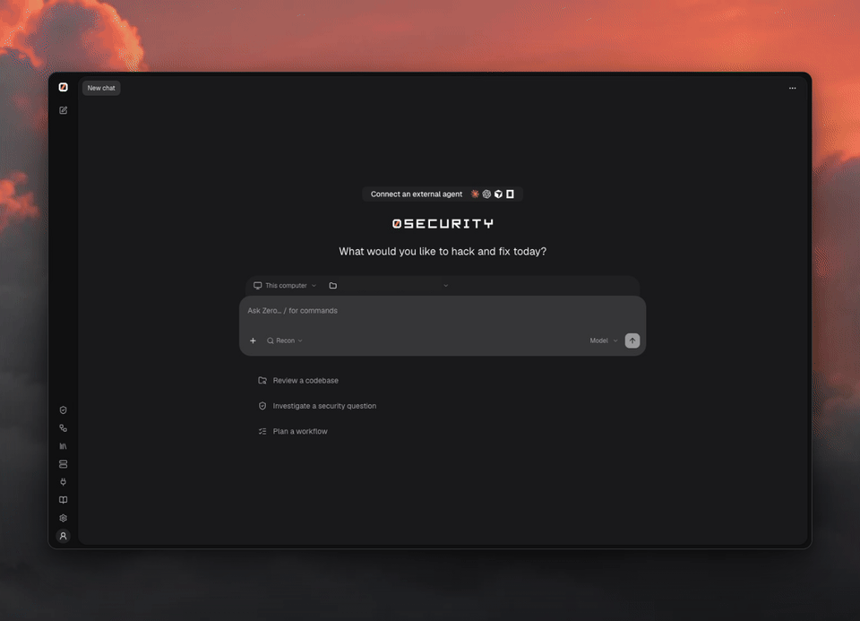
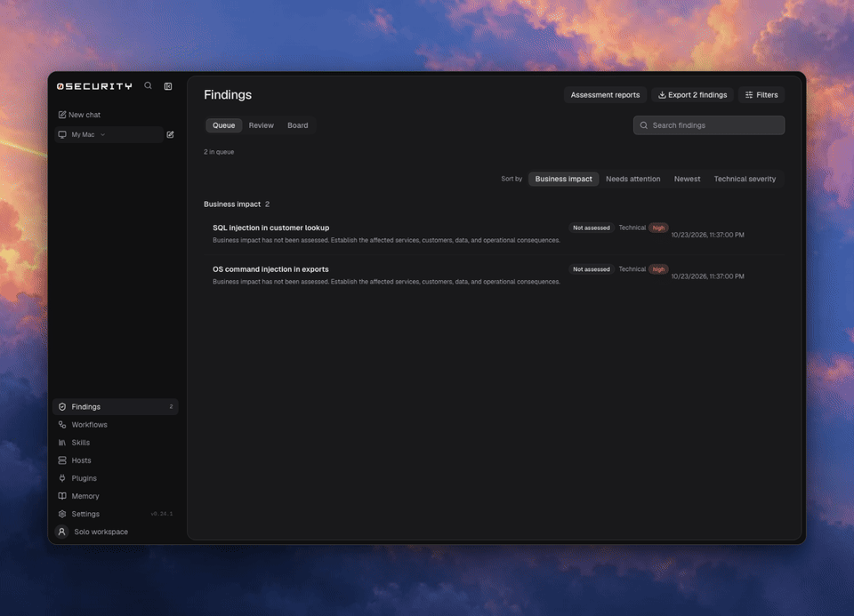
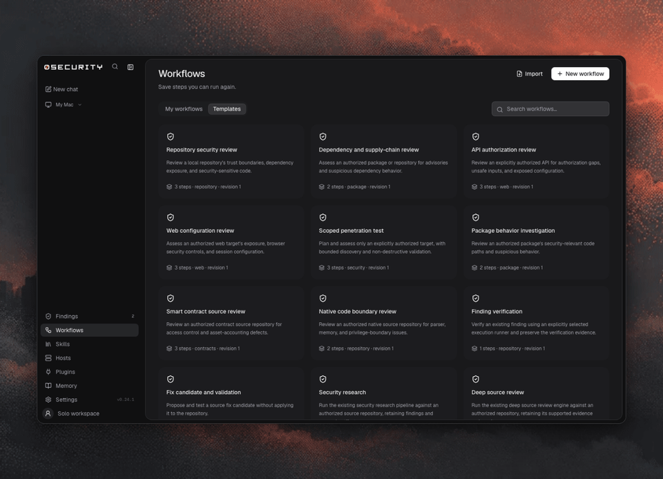
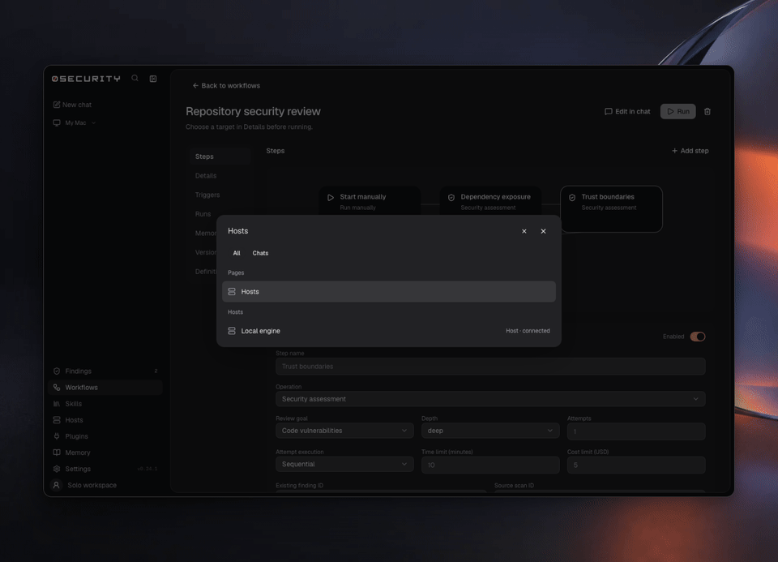
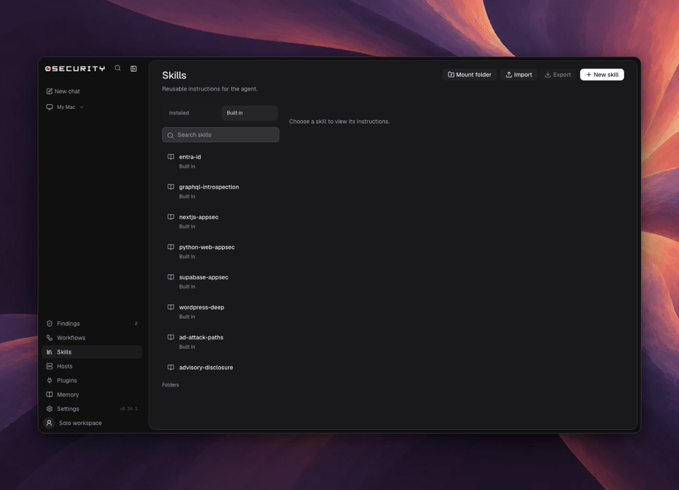

<p align="center">
  <a href="https://0.security/">
    <picture>
      <source media="(prefers-color-scheme: dark)" srcset="assets/0-aperture-white.svg">
      
    </picture>
  </a>
</p>

<h1 align="center">The open-source AI security harness</h1>

<p align="center">
  Investigate vulnerabilities, review findings, and work on fixes in your browser.<br/>
  Use your own model provider. Connect coding agents through CLI or MCP.
</p>

<p align="center">
  <a href="#get-started">Get started</a> ·
  <a href="assets/readme-ui-demo.mp4">Demo</a> ·
  <a href="https://docs.0.security/">Docs</a> ·
  <a href="https://0.security/research/">Research</a> ·
  <a href="https://github.com/0sec-labs/0/releases">Releases</a> ·
  <a href="#0cloud">0cloud</a>
</p>

<p align="center">
  <a href="assets/readme-ui-demo.mp4">
    <picture>
      <source media="(prefers-reduced-motion: reduce)" srcset="assets/readme-ui-demo.jpg">
      
    </picture>
  </a>
</p>

<p align="center">
  <sub>Backed by Y Combinator · The Swiss Applied AI &amp; Cybersecurity Research Lab</sub>
</p>

## Get started

Install on Apple Silicon macOS or x64/ARM64 Linux, then run `0`:

```bash
curl -fsSL https://raw.githubusercontent.com/0sec-labs/0/main/install.sh | bash
export PATH="$HOME/.0/bin:$PATH"
0
```

`0` opens the local browser console without an account. `0 web` remains a
compatibility alias. The interactive terminal UI is retired; headless CLI commands
and MCP remain available.

Configure a [model provider](https://docs.0.security/api-keys/) to run AI workflows.
See [installation](https://docs.0.security/getting-started/) and
[troubleshooting](https://docs.0.security/troubleshooting/).

## Findings

Review source evidence and organize findings in a queue or on the board.

<p align="center">
  <a href="assets/readme-findings.mp4">
    <picture>
      <source media="(prefers-reduced-motion: reduce)" srcset="assets/readme-findings.jpg">
      
    </picture>
  </a>
</p>

## Security workflows

Chat with 0 in the web UI, investigate findings, and use built-in templates for
assessment, verification, fixes, and research. Runs retain results; Learning
keeps local activity and source-grounded notes.

<p align="center">
  <a href="assets/readme-workflows.mp4">
    <picture>
      <source media="(prefers-reduced-motion: reduce)" srcset="assets/readme-workflows.jpg">
      
    </picture>
  </a>
</p>

For automation and coding agents, the CLI exposes the same workflow runner:

```bash
0 workflow list --templates
0 workflow run --template security-research \
  --target /absolute/path/to/repo --workspace /absolute/path/to/repo
0 runs list
0 chat --prompt "your request"
```

[Workflow guide](https://docs.0.security/workflow/) ·
[Learning](https://docs.0.security/learning/) ·
[GitHub Actions](https://docs.0.security/ci/github-action/)

## Hosts and plugins

Choose a host for your work. Connect service integrations and manage extensions.
Use ⌘K / Ctrl+K to jump between tools.

<p align="center">
  <a href="assets/readme-tools.mp4">
    <picture>
      <source media="(prefers-reduced-motion: reduce)" srcset="assets/readme-tools.jpg">
      
    </picture>
  </a>
</p>

## Skills and memory

Reuse security instructions and retain lessons linked to the source.

<p align="center">
  <a href="assets/readme-memory.mp4">
    <picture>
      <source media="(prefers-reduced-motion: reduce)" srcset="assets/readme-memory.jpg">
      
    </picture>
  </a>
</p>

## 0cloud

The hosted version of 0, for managed security workflows on your team's repositories.
Access is currently through the **[0cloud waitlist](https://0.security/waitlist/)**.
Local use does not require a cloud account.

<p align="center">
  <a href="https://0.security/waitlist/">
    
  </a>
</p>

## Connect another agent

Use CLI commands or expose workflows through MCP:

```bash
0 mcp-server --workflows --workspace /absolute/path/to/repo
```

Local MCP requires an explicitly selected host-local execution profile. Browser
chat's **Connect an external agent** provides a setup prompt. CLI and MCP workflow
clients can share a running local engine's sessions and runs.

[Plugins and MCP setup](https://docs.0.security/integrations/) ·
[Local and remote engines](https://docs.0.security/engine-connections/) ·
[Plugin development](https://docs.0.security/hackstore/)

For AI agents: [product index](https://0.security/llms.txt) ·
[command reference](https://docs.0.security/commands/).

## Development

Install dependencies, run `npm run dev`, and open the printed browser address.
See [CONTRIBUTING.md](https://github.com/0sec-labs/0/blob/main/.github/CONTRIBUTING.md).

## Status and safety

**Research preview.** Assess only authorized systems and review findings and fixes.
Use `--mode standard` with headless chat for explicit scope checks. The optional
[scope plugin](https://docs.0.security/scope/) enforces target boundaries.

Report vulnerabilities through [SECURITY.md](.github/SECURITY.md).
Licensed under [MIT](LICENSE-MIT) OR [Apache-2.0](LICENSE).

[Public disclosures and upstream fixes](https://0.security/research/#disclosures).
