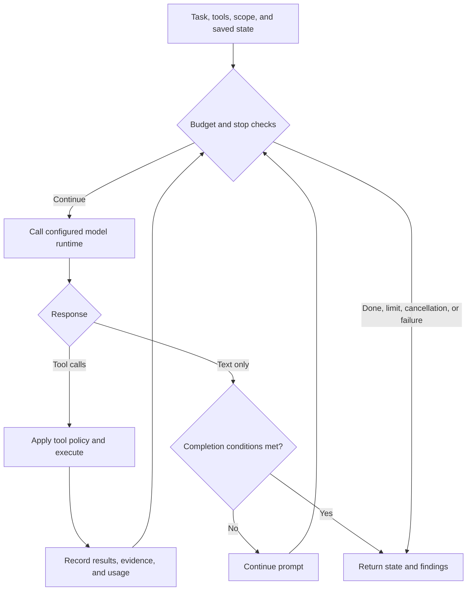

0 runs assessments by putting a model in a loop with tools. The model reads
the task, proposes tool calls, receives their results, and decides what to do
next. Deterministic tool policies, budget checks, and verification constrain
that process; model reasoning alone is not evidence.

## Loop overview

`runNativeAgentLoop` in `packages/engine/src/agent/native-loop.ts` exchanges
structured messages and tool calls through the configured runtime. Provider
adapters translate its `tool_use` / `tool_result` representation to the
appropriate wire protocol. Applicable process runtimes use a legacy text loop.



Each iteration is one **turn**. Callers can set `maxTurns`; omitting it leaves
turn count unbounded. Other budgets differ by workflow, role, and depth. The loop
can finish on `done`, a qualifying text-only completion, a limit, cancellation,
or an error. Optional compaction,
loop detection, and budget warnings operate around this cycle.

Strategy racing and EGATS are separate opt-in orchestration paths, not steps
every normal loop executes. `scan --race` is benchmark/CTF-oriented, not a
recommended setting for ordinary live-target audits.

## What the agent sees

The **system prompt** defines the role, available tools, and target approach:

- `shellPentestPrompt` (web) — emphasizes `bash`, `save_finding` and `done`,
  with curl/python3/CLI probing. The caller can still expose structured network
  tools; a prompt's preferred approach is not the executor's complete tool list.
- `discoveryPrompt` / `attackPrompt` (LLM/AI) — probing endpoints, extracting
  system prompts, testing jailbreaks.
- `researchPrompt` (source) — map the codebase, trace input → sink, write PoCs.

The prompt includes concrete target details: URL, known endpoints, detected
features, and (for attack agents) discovery results.

**Tool results** append stdout/stderr, HTTP responses, or structured output as
`tool_result` messages.

Budget prompts can nudge the model as a configured allowance is consumed.
They do not enforce spending or prove progress. See
[Budget Management](/budget-management/) for enforced limits.

## Tool execution

`ToolExecutor` in `packages/engine/src/agent/tools.ts` handles tool calls. Web mode uses:

- **`bash`** — runs shell commands and returns execution output. It is subject to
  scope and tool policy; by default it executes on the host, not in an OS sandbox.
- **`save_finding`** — records a candidate and its evidence; where database
  persistence is configured the finding survives beyond the loop. Saving alone
  is not independent verification.
- **`done`** — signals completion with a summary; sets `state.done = true` and
  exits.

Other tools by mode: `http_request`/`submit_form` (structured HTTP),
`send_prompt` (LLM), `read_file`/`run_command` (source), `crawl` (spidering),
`browser` (Playwright). `spawn_agent` creates one sub-agent with fresh context
to dig into a specific vuln; its `tasks` array launches a batch with bounded
concurrency and separate turn budgets. Console sessions with background result
delivery return immediately by default; `wait:true` waits for completion. Other
hosts block by default. Results retain each worker identity and failures do not
erase sibling results. Descendants can delegate recursively while retaining the parent's
role, scope, advertised tool restrictions, shared accounting, and cancellation tree.
They inherit root policy plus their own task, not an accumulating stack of ancestor
tasks. Separate contexts do not mean isolated host filesystems or providers.

To send a follow-up to the same directly owned background worker, call
`spawn_agent` with `agent_id` and `task`. This returns immediately. Follow-ups
cannot include a batch, shared context, worker configuration overrides or `wait:true`.

Cross-run hunt memory is off by default for local native runs. Embedded callers
can explicitly opt in through `codebaseLearning` or an injected memory store;
`ZERO_DISABLE_HUNT_MEMORY=1` or `true` vetoes either. Ordinary
conversation/session history is separate from cross-run learning.

### Model roles and completion signals

The workflow selects the main runtime; child role-model overrides remain subject
to that runtime's supported route and single-model policy. A fresh child
context is not an automatic switch of provider credentials.

Tool completion and task success are different signals. A child lifecycle
`completed` event means its loop returned normally, which can include reaching a
turn budget; inspect its findings and result rather than treating that event as
verified exploit success.

## Debugging

Use supported `--verbose` flags for progress and tool detail. Output varies by
workflow and can omit provider-transcript details. Redact logs before sharing.

Common patterns:

- **Loops on one payload** — inspect repeated tool results, scope denials, and
  access failures before increasing the budget.
- **Provider errors or empty responses** — check the reported provider/model,
  credentials, availability, and rate limits; see [Troubleshooting](/troubleshooting/).
- **Exits too early** — text-only completion requires at least
  `min(4, maxTurns ?? 4)` turns, nonempty text and `end_turn`. An accepted `done`
  can finish sooner; errors, cancellation and limits can also stop the loop.
  Do not infer a premature `done` from turn count alone.
- **Missing findings** — check `save_finding` receipts and the selected database.
  A failed assessment can retain candidates without verifying them. Saving alone
  does not establish a vulnerability.

**Saved history and timeline** — list runs, then inspect the event timeline for
a known scan ID:

```bash
0 runs history --limit 10
0 runs timeline <scan-id> --db-path ~/.0/runs/<scan-id>/state.db
```

`timeline` reads the selected database; it does not search every run-local
database by scan ID. Adjust the path if you use a different state directory.

The native loop checkpoints SQLite session state every 2 turns when a database
is configured, and persists again at completion. Journal-backed continuation
and console transcript resume are different mechanisms. Follow
[Scans](/scans/) for scan recovery and [Console](/console/)
for chat-session resume; do not assume an interrupted tool can be safely rerun.
