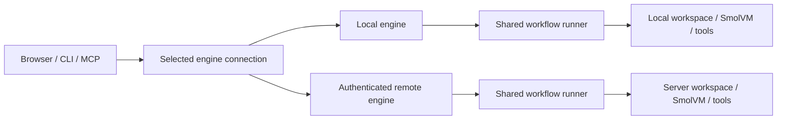
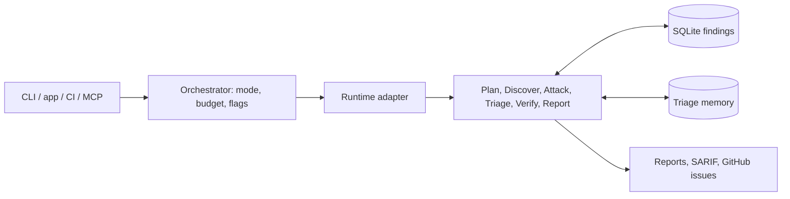

0 runs agents that find vulnerabilities, then proves them. One rule drives the design: reproduce before trusting. For setup, start with [Scan code](/scan-code/), [Scan web and APIs](/scan-web/) or the [Browser app](/app/).

## Components

| Component | Role |
| --- | --- |
| CLI (`packages/cli`) | The `0` command, the local web server, MCP server, automations and sentinels. |
| Engine (`packages/engine`) | Scan pipelines, agent loop, tools, verification, fixes, scope guard and storage. |
| Browser app (`packages/web`) | The UI that `0` opens. Talks to the engine over a same-origin proxy. |
| Bench (`packages/bench`) | Benchmark runners. See [Benchmarks](/benchmark/). |
| FoxGuard | Rust pattern scanner installed alongside 0. Feeds leads into triage. |
| 0verse | Separate in-repo Python producer of compiled-program evidence (Ghidra, angr, AFL++). Opt-in, never a stage of every scan. |

Reports retain findings with their evidence and verification state. Rows can have different proof grades. Local reports are never published for you.

## Evidence rules

Research workflows emit evidence envelopes. The stages are discover, reachability, harness, execute, verify, novelty and impact. Discover and verify are mandatory. An optional stage that cannot run is `skipped`. Failed or unavailable proof stays `inconclusive`. Discovery output cannot promote itself.

| Dimension | Values |
| --- | --- |
| Proof grade | `candidate`, `reachable`, `observed`, `reproduced`, `impact-proven` |
| Novelty | `unchecked`, `novel`, `duplicate`, `inconclusive` |
| Native evidence | Protocol attempts, sanitizer crashes, hunt records, VM proofs |

Reproduced is not disclosure-ready. Disclosure also needs a real novelty receipt, plus scope, publishability, redaction and operator policy. A proof grade never implies attacker privilege. Privilege claims have their own gates, and all fail closed:

- Linux zero-capability: attested non-root UIDs, an empty effective capability set, `no_new_privs` and a digest-bound artifact.
- Windows privilege escalation: a separate token-transition gate. Linux facts never count as Windows proof.
- Linux kernel N-of-K: every reproduced boot has a bound receipt. The aggregate manifest binds each dmesg digest and rejects mixed kernels or repeated boot IDs.

These are trusted-orchestrator bindings, not hardware attestation of a hostile worker. Human review stays mandatory. See [Specialist research](/research-workflows/) and the separate [verification result schema](/verification-result/).

### Adapters

| Adapter | Native proof | Status |
| --- | --- | --- |
| HTTP protocol conformance | Request and response plus a deterministic RFC oracle | Connected |
| Userspace memory safety | Fuzz loop, sanitizer or Miri crash, saved input | Connected |
| Agentic hunt | Best-of-N records, judge, skeptic and prover, novelty result | Connected |
| Linux kernel reproducer | Fresh-boot N-of-K signature gate with dmesg binding | Connected |
| Linux external boot matrix import | Versioned manifest, unique boot markers, clean-control gate | Connected, external provenance |
| Windows Hyper-V evidence import | 0verse receipt, clean controls, repeated crash signature | Crash reproduction only. Privilege escalation fails closed. |
| Mobile static intake | Typed candidates and scoped handoff | Connected |
| XNU IOKit | Selector discovery and deterministic programs | Partial, fail closed |
| Unified web, AI, source, package pipeline | Native findings wrapped without a rerun | Connected |

Two kernel import paths exist because the generic VM runner cannot safely rebuild those proofs. `0 research linux-matrix` imports boots that ran elsewhere and marks the envelope `executionOrigin: external`. `0 research linux` runs boots natively against a literal crash oracle (`--expected-signature`). A different oops cannot satisfy the gate, and each boot keeps its own hashed dmesg artifact.

## Execution ownership and engine connections

The CLI, browser, schedules and MCP all use the shared automation runner. Assessment shortcuts keep a one-step run. Fix, verification, research and deep review use their own typed executors. Calling one HTTP tool does not start a full assessment.

An automation defines steps. A run captures the definition, bound inputs, status and returned evidence. The runner executes connected steps in order, applies automation and step deadlines, and shares provider spend. Severity and proof status are independent of whether execution completed. The control database keeps automation snapshots and combined results. Files stay on the engine that produced them.

An engine connection picks the process that owns chats, runs, approvals, workspaces, provider connections and execution environments. Model selection picks a provider route inside that engine. Connecting to a server does not copy your repository or send your model credentials to it.

A remote engine owns its machine's execution boundaries. A remote executor, where one engine outsources tools but keeps the run, is a separate capability that does not exist. There is no generic remote shell. The browser uses a trusted same-origin proxy. Remote bearer secrets stay in the local connection service, and provider credentials stay on the engine that executes. A connection failure is a disconnected state, not proof that work stopped. Setup is on [Remote engines and teams](/engines/).

## Scan pipeline

Web pentesting is shell-first: `bash` (curl, python3, sqlmap) is the main tool, not a fixed set of HTTP tools. LLM and code targets get specialized tools such as `send_prompt` and `read_file`. The rationale and A/B data are in [Shell-first](/research/shell-first/).

The six labels are a conceptual flow, not six agents. Native agentic verification uses one bounded session per candidate. Optional discovery fan-out adds more sessions.

1. **Research agent** (plan, discover, attack, record). It picks likely classes, maps endpoints and source, tests hypotheses with target-specific tools, and saves evidence and PoCs. These are model tasks. They do not guarantee full coverage or a working PoC on every finding. A scope document is passed in as context. The console keeps common tools loaded and brings specialist tools in through `list_tools` and `load_tool`. Loading a tool does not change its permissions.
2. **Triage.** Default-on filters, category oracles and optional source, proof-of-vulnerability and consensus gates. See [Triage and validation](/triage/).
3. **Verify.** One finding at a time, with its request and response excerpts, original analysis and review memory, in a fresh session. It is not blind to all reasoning. See [Triage and validation](/triage/#blind-verification).
4. **Report.** Terminal, HTML, PDF, SARIF, Markdown or JSON. See [Reports and disclosure](/reports/).

Budgets depend on workflow, role and depth. See [Agent loop](/agent-loop/) and [Costs and budgets](/budgets/). The 2026-04-11 ablation found that EGATS tree search lowers solve rate on hard challenges at about ten times the cost of the next-worst layer, so it is opt-in. See the [ablation log](/research/2026-04-11-ablation/).

### Multi-model roles

Different models can serve discovery, review, refutation and fix roles when the route supports it. Several sessions do not mean several providers or independent errors. API child runtimes keep the parent provider, credential and base URL. A role-model name must work on that route. See [Models and keys](/models/).

## Scan modes

| Mode | Target | What it does |
| --- | --- | --- |
| `deep` | LLM API URL | Multi-turn prompt injection, jailbreak, tool poisoning and exfiltration probing. |
| `probe` | LLM API URL | Light surface scan. |
| `web` | Web app URL | CORS, headers, exposed files, SSRF, XSS, path traversal, fingerprinting. |
| `mcp` | MCP server | Tool poisoning, schema abuse, permission escalation. |
| `http_audit` | Authenticated HTTP target | Scoped assessment driven by `ZERO_TARGET_*` settings. |

Package audits and source reviews are separate modules: `scan package` and `scan source`.

## Runtime adapters

The pipeline does not depend on one model backend. Each adapter implements one interface.

| Adapter | Backend |
| --- | --- |
| `LlmApiRuntime` | A configured API provider, with native tool calls. |
| `ProcessRuntime` | The Claude, Codex or Gemini CLI as a subprocess. Not a tool sandbox. |
| `CliNativeRuntime` | A supported installed coding CLI, with CLI-native sessions. |
| `OllamaRuntime` | Local Ollama. |

`createRuntime(config)` builds API, process or Ollama runtimes from `config.type`. `auto` is a selection policy, not a class. MCP is separate from the model runtime. See [Configuration](/configuration/#runtime-modes).

## Execution isolation

A runtime adapter is not an execution sandbox. Three choices are independent.

| Layer | Responsibility | Current choice |
| --- | --- | --- |
| Controller | Provider auth, scope, budgets, approvals, evidence | 0's TypeScript harness |
| Toolbox artifact | Filesystem with tools and dependencies | OCI image, provisioned before execution |
| Execution engine | Host and guest boundary, mounts, network, limits, teardown | Apple Silicon SmolVM workbench. Docker or Linux SmolVM for separately configured offline workers. |

OCI is the image format. It does not mean Docker execution. SmolVM boots the image in a microVM with its own guest kernel, while Docker containers share the host kernel. Workbench setup approves a local archive by SHA-256 and runs an independently verified private copy. A mutable VM or a model-chosen registry tag is not a substitute. Setup is under [Configuration](/configuration/#execution-profile).

## Rust boundary

Decision: keep the TypeScript harness and evaluate a small native execution supervisor before any full rewrite. A separate process with a versioned protocol is safer than adding native failure modes inside the credential-bearing controller. Candidate duties are process ownership, PTYs, OS confinement, resource accounting and confirmed teardown. Rust does not provide those guarantees by itself.

Before a port, measure CLI startup, peak memory, controller CPU, cancellation latency and sustained output. Require parity for scope, credentials, sessions, evidence and rollback. No benchmark so far shows that a full rewrite is warranted. The reasoning is in [TypeScript and Rust boundary](/research/typescript-rust-boundary/).

## MCP

0 uses MCP in three roles.

- Client: selected agent and console paths connect to external MCP servers and expose their tools.
- Server: `0 mcp-server` exposes a scoped subset of tools over stdio. `--tools` is an allowlist, not a grant. Every tool still passes 0's execution and engagement guards, and 0 owns scope, rate limits, persistence and verifier state.
- Scan target: `--mode mcp` probes a server for tool poisoning, schema abuse and privilege escalation.

See [Agents and MCP](/mcp/).

## Storage

Fresh CLI scans write a run-local `~/.0/runs/<scan-id>/state.db`, journal and report. Explicit database paths, resume, the app and SDK callers choose their own storage. The dashboard reads one database at a time through `--db-path`.

## Agent tools

| Tool | Used in | Purpose |
| --- | --- | --- |
| `bash` | Web, LLM, verify | Shell commands under tool, scope and engagement limits. Runs on the host by default. |
| `browser` | Web | Headless Playwright for XSS and JS-rendered pages. |
| `save_finding` | Finding-producing roles | Record a candidate and its evidence. Does not verify it. |
| `done` | All | Signal completion. |
| `send_prompt` | LLM | Send prompts to AI apps. |
| `read_file`, `list_files` | Source, package | Read and list source. |
| `search_files` | Scoped source, package | Literal search in text files, within scope and size limits. |
| `run_command` | Profiles with local execution | Run an installed command on the host. Not a sandbox. |
| `crawl`, `submit_form`, `http_request` | Network roles | Structured HTTP next to shell-first work. |

Tool sets depend on role, target, scope and enabled features.
