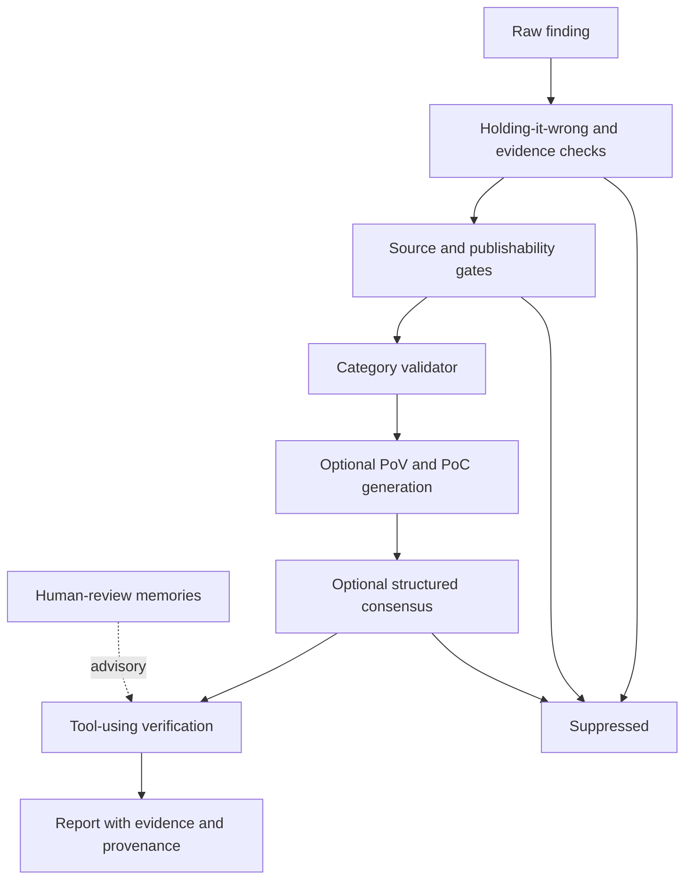

Between finding generation and the report, 0 filters candidates, runs category validators and sends survivors to a verifier. Which checks run depends on the command, target, category, runtime and feature flags. An `accepted` label is not a universal reproduction or disclosure verdict.

Inspect what ran for one finding:

```bash
0 findings show <finding-id>
```

Turn on the stronger gates for a web scan:

```bash
0 scan web --features fp-moat --target https://example.com --scope ./scope.json
```

## Pipeline



The stages below are a capability list, not a fixed order. Triage modules are in `packages/engine/src/triage/`.

Suppression is guarded. Heuristic rejection checks `isDisclosureWorthy`. A protected high-severity finding is held for more verification instead of dropped. An error, an unknown result or a missing execution record is never proof that a target is safe.

## Gates

| Gate | Default | Variable | What it does |
| --- | --- | --- | --- |
| Holding-it-wrong | on | `ZERO_FEATURE_HOLDING_IT_WRONG=0` disables | Catches documented sink behavior mistaken for a bug, such as a file-writing API reported as arbitrary file write. Suppressible matches become `info` and `false-positive`. |
| Evidence completeness | on | `ZERO_FEATURE_EVIDENCE_GATE=0` disables | A 45-signal feature vector is stored as `triage_features`. Findings with `evidence_completeness <= 0.5` can be suppressed. |
| Reachability | off | `ZERO_FEATURE_REACHABILITY_GATE=1` | With source, a conservative pattern pass checks paths, entry points and imports. When unsure it says reachable. Not an interprocedural proof. |
| Multi-modal | off | `ZERO_FEATURE_MULTIMODAL=1` | With source and the FoxGuard binary, cross-checks each finding against FoxGuard output. Both firing raises priority. Only 0 firing is not a refutation by itself. |
| Publishability | off | `ZERO_FEATURE_PUBLISHABILITY_GATE=1` | Checks whether a finding is worth publishing. |
| PoV generation | off | `ZERO_FEATURE_POV_GATE=1` | Runs a category validator or a bounded PoC generation path. Inconclusive results are annotated, not treated as false positives. A generated script is not proof it ran. |
| Static PoC | off | `ZERO_FEATURE_POC_GEN_STATIC=1` | Generates a static PoC for source findings. |
| Consensus | off | `ZERO_FEATURE_CONSENSUS_VERIFY=1` | Three parallel structured model assessments per candidate. Early majority can end it before all calls settle, and their cost is not refunded. |
| Learned router, dynamic triage | off | `ZERO_FEATURE_LEARNED_ROUTER`, `ZERO_FEATURE_DYNAMIC_TRIAGE` | Decide which gates to skip per finding. See [Finding triage ML](/research/finding-triage-ml/). |

`--features fp-moat` (or `ZERO_FEATURE_PRESET=fp-moat`) turns on six gates: reachability, multi-modal, publishability, PoV, static PoC and consensus. It leaves out the router flags, because skipping layers would hide what you are measuring. A flag you set yourself wins, so `ZERO_FEATURE_POV_GATE=0` ablates one layer.

Historical results vary by slice: better XBOW black-box results, a 0 to 2 flag cost on white-box, no change on npm-bench. Findings dropped about 60% with a roughly flat correct-flag count. Measure on your own target. See [False-positive reduction](/research/false-positive-reduction/) and the [2026-04-11 ablation](/research/2026-04-11-ablation/).

EGATS (`scan --egats`) is a hidden, opt-in discovery search, not a triage stage. The ablation found it regresses hard challenges.

### Structured verification

`triage/structured-verify.ts` asks four questions: reachability, payload validity, impact and exploit confirmation. Each is a model call with no tools. Every step must return a passing verdict, and a failed or malformed step gives `rejected`. This assesses evidence. It does not reproduce anything.

## Validators

Category validators run real probes and judge the observation with ordinary code. A model's agreement does not count.

| Category | What the validator observes | Limits |
| --- | --- | --- |
| Reflected XSS | Chromium captures an alert carrying a fresh random token. | Needs Playwright and Chromium. Reflection alone stays unverified. Stored and DOM XSS are not fully covered. |
| SQL injection | At least two of: response-size difference, delayed response, database error pattern. | Unstable pages and generic errors mislead it. |
| SSRF | A local HTTP collector receives the probe's nonce. | The target must be able to reach the collector. A remote target's loopback is not yours. |
| Command and code injection | A local collector receives a nonce after command-shaped probes. | Callbacks need review to tell command execution from other URL fetches. |
| Path traversal | A response contains a passwd-like signature. | Static text can look like it. Linux only. |
| ID and resource access | A known fixture is replayed as an owner and comparison identities, and both responses carry the private owner marker. | Needs distinct credentials and declared ownership. Without a fixture, numeric-ID differences stay unverified. |

The agentic web scan runs these during verification. Its `save_finding` hook can also return inline validator feedback for high and critical findings. Static reviews, chat messages and other commands do not run them automatically.

A successful XSS execution is stronger than HTML reflection. An HTTP 200, changed text or a zero exit code is not an exploit claim. An unavailable browser, unreachable collector, missing auth or broken fixture means the validator could not decide. It does not mean the app is safe.

The oracle result (`verified`, `confidence`, `evidence`, `reason`) is separate from the replay JSON in [Verification result schema](/verification-result/).

### Authenticated IDOR fixtures

Pass restricted identities and known ownership fixtures to `scan web`:

```bash
0 scan web --target https://app.example.test --scope ./scope.json \
  --identities identities.json --access-control-fixtures fixtures.json
```

`--identities` takes a restricted JSON file of named identities: for example an owner admin, a second tenant admin and a member. An identity with no `auth` is an anonymous control. Do not combine it with `--auth`.

`--access-control-fixtures` takes an array of read-only ownership contracts. Seed a private synthetic marker in the owner tenant first:

```json
[
  {
    "url": "https://app.example.test/api/artifacts/known-uuid",
    "ownerIdentity": "tenant-a-admin",
    "comparisonIdentities": ["tenant-b-admin", "tenant-a-member"],
    "ownershipMarker": "PRIVATE_SYNTHETIC_OWNER_CANARY_12345"
  }
]
```

Do not use public names or shared fields as markers. A fixture matches the exact GET URL, including the query string, and cannot authorize a destination. Public pages, a status code without the marker, stale sessions and identical credentials cannot confirm an ownership break. For unauthorized changes, use `access_control_workflow` with a disposable resource and an owner-side check before and after.

### Limits

- Probes run only where you approve them. The oracle's direct HTTP transport is not a complete scope boundary. Inline, batch and delegated PoV checks use the scan executor's scoped transport. Standalone oracle calls without a context use direct fetch.
- Raw HTTP evidence keeps application headers and JSON or form bodies. Configured identity credentials replace recorded auth.
- A validator result does not prove isolation or authorization.
- To run the browser qualification from a source checkout with Playwright Chromium installed: `ZERO_TEST_BROWSER_ORACLES=1 pnpm --filter @0/engine exec vitest run src/triage/oracles.browser.test.ts src/triage/oracles.test.ts`.
- `HuntScanOptions.runtimeVerify` is an SDK hook for a runtime verifier. 0 ships no provisioner for it. Supply the executor, startup descriptor, egress, credential isolation, limits and teardown yourself.

## Blind verification

0 separates discovery from verification on several paths. A fresh agent context reduces shared conversational bias. It does not guarantee a different model, an information-blind prompt or a reproduction of every finding.

| Path | Verifier receives | Limits |
| --- | --- | --- |
| Native agentic scan | One finding: ID, title, category, severity, request and response excerpts, analysis excerpt, target and auth context, optional review memories. | A separate session per finding, 5 turns each. Tools replay the claim and `update_finding` records the decision. |
| Legacy agentic scan | A list of findings with excerpts, target and auth. | Shared session, `min(findingCount * 3, 15)` turns. |
| Template scan | Template name, category, payload and response, target. | One combined session when an API runtime is available. Otherwise the fallback below. |
| Structured verification | Finding and target in four prompts. | Model assessment without tools. |
| Source review and hunt | Source-specific review or configured skeptic and prover gates. | Can show source-backed plausibility without running the program. |

The native prompt includes up to 1,000 characters each of the request and response and 600 of analysis. The verifier does not see the full conversation, but it is not blind to the finding's reasoning.

A fresh pass can catch refusals that echo an instruction, non-deterministic responses that fail on retry, payloads that need earlier context, and partial compliance without the claimed leak. A failed retry does not prove a bug is absent.

### Finding lifecycle

`save_finding` records a candidate, not proof. On the agentic path, the verifier replays the attack, tries variations and calls `update_finding` with `confirmed` or `false-positive`. A stopped session need not decide every candidate. Automated verification, `triageStatus` and human accept or suppress are separate signals.

### Fallback without an API runtime

If the template stage cannot get an API runtime, a template with two or more vulnerable results is confirmed. One result counts as a false positive. Existing `discovered` findings are promoted to `confirmed` without a new agent run. This fallback does not replay the payload. Do not present its `confirmed` label as reproduction. Where the database supports it, verdicts are stored as `TRUE_POSITIVE` (confidence 0.8) or `FALSE_POSITIVE` (0.7). Those are fixed labels, not probabilities.

### What each approach shows

| Approach | It shows |
| --- | --- |
| Tool-using agent verification | A fresh attempt. You still inspect the evidence. |
| Structured model assessment, consensus | Model judgments of the supplied evidence. |
| Template fallback | Vulnerable-response labels, with no new replay. |
| Deterministic replay | Declared steps and assertions run by a chosen runner. See [Verification result schema](/verification-result/). |
| Research evidence envelope | A proof grade and provenance, plus any novelty or privilege receipts. |

Verification costs time and money. A skipped check or unavailable evaluator leaves uncertainty, not proof of safety.

## Triage memory

Mark false positives so later verification has context:

```bash
0 findings triage mark-fp <finding-id> --reason "test fixture, not prod"
0 findings triage memory add --finding <id> --reason "sink is a harmless helper" --scope package --scope-value my-pkg
0 findings triage memory list --scope target
0 findings triage memory remove <id>
```

Scope is exact: `global`, an inferred `package`, or a `target` URL or path, within the finding's category. Ranking uses token overlap. A memory never auto-rejects a finding. It is advisory, untrusted context for the verifier and is not reproduction evidence. A memory in another database is not available to every run. See [Findings](/findings/).

## Layer execution records

Each layer records a verdict as it runs. `0 findings show` prints them:

```
  Triage provenance:
  Layers: 3 executed, 5 skipped, 3 unrecorded | 412ms | $0.0000
    + holding_it_wrong   executed(pass) - no holding-it-wrong pattern matched
    + evidence_gate      executed(pass) - evidence_completeness=0.83 > 0.5
    - reachability       skipped(skip) - ZERO_FEATURE_REACHABILITY_GATE=0
```

- Verdicts are stored on each finding. Changing shell flags later does not change history.
- `skipped` means the layer stood down and named why. `unrecorded` means no verdict exists.
- `structured_verify`, `consensus` and `kernel_oracle` emit no verdict records, so they show as unrecorded, not skipped.

Optional semantic dedupe runs in report post-processing and keeps the original evidence. Grouping is not verification and not a novelty receipt.

## Related

[Agent loop](/agent-loop/), [Verify and fix](/verify-and-fix/), [Finding triage ML](/research/finding-triage-ml/), [Triage dataset](/research/triage-dataset/).
