# Nearby-device radar map

_Capture: demo.jsonl_

## RING 1 — within arm's reach (<3m)

- `F7980771` **unnamed** — Handoff,NearbyInfo (rssi -46..-56, 189 obs)
- `031BC8B1` **unnamed** — Handoff,NearbyInfo (rssi -45..-55, 148 obs)
- `7CC51B29` **unnamed** — HeySiri,NearbyInfo (rssi -51..-70, 128 obs)
- `47A7FFC9` **PeakPhone** — HeySiri,NearbyInfo (rssi -36..-57, 120 obs)
- `5D30A33D` **unnamed** — NearbyInfo (rssi -43..-69, 87 obs)
- `64ED2310` **unnamed** — NearbyInfo (rssi -44..-65, 84 obs)
- `4072EB99` **unnamed** — NearbyAction (rssi -43..-66, 76 obs)
- `5F224C22` **unnamed** — NearbyAction (rssi -46..-55, 57 obs)
- `5F74EBE0` **unnamed** — FindMy (rssi -48..-69, 14 obs)
- `0DD4A031` **unnamed** — FindMy (rssi -42..-56, 8 obs)
- `9F5D9023` **unnamed** — NearbyAction (rssi -55..-67, 7 obs)
- `ECECFAB1` **unnamed** — FindMy (rssi -54..-65, 7 obs)

## RING 2 — same room (3-10m)

- `1CABDC9B` **unnamed** — Handoff,NearbyInfo (rssi -62..-81, 145 obs)
- `F9B3F02B` **unnamed** — Handoff,NearbyInfo (rssi -62..-78, 138 obs)
- `B43D3835` **unnamed** — Handoff,NearbyInfo (rssi -68..-80, 128 obs)
- `A6E4E255` **unnamed** — NearbyInfo (rssi -64..-97, 119 obs)
- `1E519705` **unnamed** — Handoff,NearbyInfo (rssi -68..-84, 108 obs)
- `E4F8010F` **unnamed** — iBeacon (rssi -67..-86, 106 obs)
- `80F9DE9B` **unnamed** — NearbyInfo (rssi -64..-90, 101 obs)
- `14A12049` **unnamed** — Handoff,NearbyInfo (rssi -66..-87, 94 obs)
- `CFAFFC4B` **unnamed** — HeySiri,NearbyInfo (rssi -68..-91, 93 obs)
- `1AD0175E` **unnamed** — ProximityPairing (rssi -64..-86, 90 obs)
- `A0D0AB4C` **unnamed** — NearbyInfo (rssi -63..-93, 87 obs)
- `B31C9B13` **unnamed** — HeySiri,NearbyInfo (rssi -68..-90, 86 obs)
- `EB299856` **unnamed** — Handoff,NearbyInfo (rssi -66..-88, 85 obs)
- `F6D392CD` **unnamed** — HeySiri,NearbyInfo (rssi -70..-93, 83 obs)
- `73639CAC` **unnamed** — NearbyInfo (rssi -63..-93, 81 obs)
- `99D12BB4` **unnamed** — ProximityPairing (rssi -63..-94, 80 obs)
- `3F9E5FC3` **unnamed** — AirPrint (rssi -66..-82, 77 obs)
- `4C37516C` **unnamed** — HeySiri,NearbyInfo (rssi -68..-87, 75 obs)
- `D6ED0449` **unnamed** — NearbyInfo (rssi -58..-85, 75 obs)
- `82F47C2B` **unnamed** — NearbyInfo (rssi -60..-78, 74 obs)
- `79F87EC5` **unnamed** — NearbyInfo (rssi -60..-76, 73 obs)
- `635A8D8F` **unnamed** — NearbyInfo (rssi -62..-74, 64 obs)
- `1B1D8411` **unnamed** — NearbyInfo (rssi -67..-84, 60 obs)
- `59422340` **unnamed** — NearbyInfo (rssi -64..-84, 59 obs)
- `30673719` **unnamed** — NearbyAction (rssi -61..-74, 59 obs)
- `D6DA35C1` **unnamed** — AirDrop (rssi -63..-92, 58 obs)
- `58F86BC0` **unnamed** — NearbyAction (rssi -63..-86, 56 obs)
- `0ABAB860` **4** — HeySiri,NearbyInfo (rssi -70..-91, 56 obs)
- `FE31DA54` **unnamed** — NearbyInfo (rssi -64..-84, 56 obs)
- `976311C2` **unnamed** — NearbyAction (rssi -65..-82, 56 obs)
- `FE3B121F` **unnamed** — NearbyAction (rssi -58..-78, 55 obs)
- `9B04BF18` **unnamed** — ProximityPairing (rssi -66..-88, 54 obs)
- `34453BC0` **unnamed** — HeySiri,NearbyInfo (rssi -65..-92, 54 obs)
- `07B9BBF2` **unnamed** — ProximityPairing (rssi -61..-75, 52 obs)
- `5099D4A5` **unnamed** — NearbyAction (rssi -63..-91, 50 obs)
- `06218272` **unnamed** — NearbyInfo (rssi -67..-84, 49 obs)
- `4A92FE1E` **unnamed** — NearbyAction (rssi -60..-74, 49 obs)
- `4D16D9CA` **unnamed** — NearbyAction (rssi -67..-85, 47 obs)
- `5DDB79B5` **unnamed** — ProximityPairing (rssi -71..-86, 47 obs)
- `B5E4667F` **unnamed** — NearbyInfo (rssi -64..-86, 46 obs)
- `F3D50AE1` **unnamed** — NearbyAction (rssi -69..-83, 43 obs)
- `89DC2519` **unnamed** — NearbyAction (rssi -74..-93, 40 obs)
- `AA343AB7` **unnamed** — NearbyInfo (rssi -75..-89, 30 obs)
- `58F5127B` **unnamed** — ProximityPairing (rssi -62..-86, 28 obs)
- `B0120B79` **unnamed** — NearbyInfo (rssi -67..-86, 26 obs)
- `99B16129` **unnamed** — NearbyInfo (rssi -68..-84, 19 obs)
- `C7B437A8` **unnamed** — NearbyInfo (rssi -62..-71, 13 obs)
- `5DEC8F84` **unnamed** — FindMy,ProximityPairing (rssi -66..-76, 13 obs)
- `1005DBDA` **unnamed** — NearbyAction (rssi -62..-74, 10 obs)
- `BA14ACDB` **unnamed** — FindMy (rssi -64..-86, 8 obs)
- `8D1D2619` **unnamed** — NearbyAction (rssi -67..-84, 8 obs)
- `D5D8E915` **unnamed** — FindMy (rssi -65..-82, 8 obs)
- `5359106B` **unnamed** — ProximityPairing (rssi -75..-92, 7 obs)
- `4E86B3F9` **unnamed** — NearbyInfo (rssi -63..-68, 7 obs)
- `C4CBBC62` **unnamed** — ProximityPairing (rssi -71..-82, 7 obs)
- `3A7715B0` **unnamed** — FindMy (rssi -72..-80, 7 obs)
- `E76D87A2` **unnamed** — FindMy (rssi -73..-88, 7 obs)
- `A485506A` **unnamed** — FindMy (rssi -62..-70, 7 obs)
- `FB5C838C` **unnamed** — FindMy (rssi -68..-90, 7 obs)
- `7BD5C3E3` **unnamed** — ProximityPairing (rssi -65..-76, 7 obs)
- `EDAAC430` **unnamed** — FindMy (rssi -63..-73, 6 obs)
- `7AE5AC00` **unnamed** — FindMy (rssi -66..-78, 6 obs)
- `7C1C0AD0` **unnamed** — ProximityPairing (rssi -69..-85, 6 obs)
- `2363C162` **unnamed** — FindMy (rssi -68..-80, 5 obs)
- `AEB51B1E` **unnamed** — FindMy (rssi -63..-76, 5 obs)
- `64C50C89` **unnamed** — FindMy (rssi -71..-92, 5 obs)
- `F855BA83` **unnamed** — FindMy,ProximityPairing (rssi -74..-80, 5 obs)
- `FB15666F` **unnamed** — FindMy (rssi -69..-79, 4 obs)
- `13A193AF` **unnamed** — FindMy (rssi -71..-76, 4 obs)
- `346A1BB9` **unnamed** — FindMy (rssi -64..-74, 3 obs)
- `10E744B0` **unnamed** — FindMy (rssi -71..-80, 3 obs)
- `9DF9E4F5` **unnamed** — FindMy (rssi -73..-77, 3 obs)

## RING 3 — building floor (10-25m)

- `BA64606D` **unnamed** — NearbyInfo (rssi -78..-92, 62 obs)
- `F620977C` **unnamed** — ProximityPairing (rssi -79..-90, 40 obs)
- `21413618` **unnamed** — iBeacon (rssi -86..-97, 38 obs)
- `1B9215E8` **unnamed** — NearbyAction (rssi -79..-92, 22 obs)
- `7A4D199C` **unnamed** — NearbyAction (rssi -78..-86, 20 obs)
- `6B9B775F` **BCPro_203739** — iBeacon (rssi -77..-80, 16 obs)
- `77803DD2` **unnamed** — NearbyInfo (rssi -87..-94, 15 obs)
- `D5BE4CC4` **unnamed** — NearbyInfo (rssi -88..-96, 14 obs)
- `A74181A1` **unnamed** — NearbyInfo (rssi -89..-95, 9 obs)
- `5D899BAA` **unnamed** — NearbyAction (rssi -87..-96, 7 obs)
- `B754E1AB` **unnamed** — FindMy (rssi -82..-91, 6 obs)
- `66D671AE` **unnamed** — FindMy (rssi -84..-92, 5 obs)
- `917AE168` **unnamed** — FindMy (rssi -78..-82, 2 obs)
- `0F4B9CCC` **unnamed** — FindMy (rssi -89..-92, 2 obs)
- `B9893580` **unnamed** — FindMy,ProximityPairing (rssi -88..-88, 2 obs)
- `B944E4B9` **unnamed** — FindMy (rssi -89..-90, 2 obs)
- `8A7F9090` **unnamed** — NearbyAction (rssi -82..-83, 2 obs)

## RING 4 — edge of range

- `AA54EAC5` **unnamed** — NearbyInfo (rssi -95..-97, 8 obs)
- `B31E49A2` **unnamed** — NearbyInfo (rssi -93..-96, 5 obs)
- `1F98F1AA` **unnamed** — NearbyInfo (rssi -93..-97, 5 obs)
- `02E31120` **unnamed** — NearbyAction (rssi -94..-97, 3 obs)
- `0F0C89ED` **unnamed** — FindMy (rssi -93..-93, 2 obs)
- `3164A820` **unnamed** — FindMy (rssi -91..-91, 2 obs)
- `22137D61` **unnamed** — NearbyInfo (rssi -95..-96, 2 obs)
- `E75AE42F` **unnamed** — NearbyAction (rssi -96..-96, 1 obs)
- `DFFBA427` **unnamed** — FindMy (rssi -91..-91, 1 obs)
- `F962CCBB` **unnamed** — NearbyInfo (rssi -92..-92, 1 obs)
- `5E715B7E` **unnamed** — NearbyAction (rssi -96..-96, 1 obs)
- `DC8C4C06` **unnamed** — NearbyAction (rssi -93..-93, 1 obs)
- `3D05C2EA` **unnamed** — FindMy (rssi -97..-97, 1 obs)
- `C50BD1B5` **unnamed** — NearbyInfo (rssi -94..-94, 1 obs)
- `03093472` **unnamed** — NearbyInfo (rssi -95..-95, 1 obs)
- `971CB325` **unnamed** — NearbyAction (rssi -96..-96, 1 obs)
- `7977DC2A` **unnamed** — NearbyAction (rssi -94..-94, 1 obs)

```mermaid
gantt
    title Top devices by observation count
    dateFormat X
    axisFormat %s
    F7980771 :aF79807, 1791956158609, 89000
    031BC8B1 :a031BC8, 1791956162219, 85957
    1CABDC9B :a1CABDC, 1791956159539, 88354
    F9B3F02B :aF9B3F0, 1791956161319, 86617
    7CC51B29 :a7CC51B, 1791956158040, 89262
    B43D3835 :aB43D38, 1791956167032, 80877
    PeakPhone :a47A7FF, 1791956157735, 88682
    A6E4E255 :aA6E4E2, 1791956164338, 81792
```

## Category counts

- NearbyInfo: 47
- FindMy: 31
- NearbyAction: 24
- ProximityPairing: 14
- Handoff: 8
- HeySiri: 8
- iBeacon: 3
- AirDrop: 1
- AirPrint: 1
