# Nearby-device radar map

_Capture: ble_map.jsonl_

## RING 1 — within arm's reach (<3m)

- `031BC8B1` **unnamed** — Handoff,NearbyInfo (rssi -44..-76, 171 obs)
- `F7980771` **unnamed** — Handoff,NearbyInfo (rssi -44..-62, 167 obs)
- `47A7FFC9` **PeakPhone** — HeySiri,NearbyInfo (rssi -41..-57, 105 obs)
- `5D30A33D` **unnamed** — NearbyInfo (rssi -47..-68, 78 obs)
- `64ED2310` **unnamed** — NearbyInfo (rssi -47..-68, 66 obs)
- `4072EB99` **unnamed** — NearbyAction (rssi -47..-67, 54 obs)
- `5F224C22` **unnamed** — NearbyAction (rssi -45..-59, 48 obs)
- `5F74EBE0` **unnamed** — FindMy (rssi -49..-63, 23 obs)
- `F2F7AC59` **unnamed** — FindMy (rssi -42..-54, 3 obs)
- `0DD4A031` **unnamed** — FindMy (rssi -44..-44, 2 obs)

## RING 2 — same room (3-10m)

- `14A12049` **unnamed** — Handoff,NearbyInfo (rssi -64..-75, 183 obs)
- `EB299856` **unnamed** — Handoff,NearbyInfo (rssi -65..-81, 166 obs)
- `1E519705` **unnamed** — Handoff,NearbyInfo (rssi -69..-83, 151 obs)
- `B43D3835` **unnamed** — Handoff,NearbyInfo (rssi -70..-89, 145 obs)
- `B31C9B13` **unnamed** — HeySiri,NearbyInfo (rssi -66..-86, 141 obs)
- `E40399A7` **unnamed** — HeySiri,NearbyInfo (rssi -57..-70, 109 obs)
- `F9B3F02B` **unnamed** — Handoff,NearbyInfo (rssi -62..-80, 98 obs)
- `E4F8010F` **unnamed** — iBeacon (rssi -63..-83, 93 obs)
- `1CABDC9B` **unnamed** — Handoff,NearbyInfo (rssi -63..-81, 92 obs)
- `1AD0175E` **unnamed** — ProximityPairing (rssi -66..-87, 88 obs)
- `A0D0AB4C` **unnamed** — Handoff,NearbyInfo (rssi -68..-88, 85 obs)
- `3618594E` **unnamed** — NearbyInfo (rssi -63..-84, 81 obs)
- `73639CAC` **unnamed** — Handoff,NearbyInfo (rssi -67..-86, 81 obs)
- `3F9E5FC3` **unnamed** — AirPrint (rssi -64..-79, 80 obs)
- `0ABAB860` **4** — HeySiri,NearbyInfo (rssi -68..-87, 79 obs)
- `CFAFFC4B` **unnamed** — HeySiri,NearbyInfo (rssi -65..-84, 76 obs)
- `4C37516C` **unnamed** — HeySiri,NearbyInfo (rssi -70..-91, 75 obs)
- `557BAC16` **unnamed** — NearbyInfo (rssi -62..-84, 70 obs)
- `DC96722D` **unnamed** — HeySiri,NearbyInfo (rssi -68..-93, 70 obs)
- `F3D50AE1` **unnamed** — NearbyAction (rssi -70..-88, 67 obs)
- `FE31DA54` **unnamed** — NearbyInfo (rssi -66..-80, 61 obs)
- `B5E4667F` **unnamed** — NearbyInfo (rssi -66..-79, 59 obs)
- `8E47E2E4` **unnamed** — NearbyAction (rssi -67..-85, 58 obs)
- `BDBDAF56` **unnamed** — NearbyInfo (rssi -60..-79, 58 obs)
- `C7B437A8` **unnamed** — NearbyInfo (rssi -60..-78, 57 obs)
- `4E86B3F9` **unnamed** — NearbyInfo (rssi -62..-80, 56 obs)
- `0D77D2CB` **unnamed** — NearbyInfo (rssi -61..-78, 55 obs)
- `4EF0A5A6` **unnamed** — HeySiri,NearbyInfo (rssi -66..-89, 53 obs)
- `924FFA00` **unnamed** — NearbyInfo (rssi -68..-89, 52 obs)
- `976311C2` **unnamed** — NearbyAction (rssi -65..-79, 52 obs)
- `1005DBDA` **unnamed** — NearbyAction (rssi -61..-83, 52 obs)
- `FB2E5467` **unnamed** — NearbyAction (rssi -61..-80, 52 obs)
- `9B04BF18` **unnamed** — ProximityPairing (rssi -67..-83, 49 obs)
- `BA4692ED` **unnamed** — AirDrop (rssi -64..-84, 48 obs)
- `5099D4A5` **unnamed** — NearbyAction (rssi -67..-87, 45 obs)
- `84787729` **unnamed** — NearbyInfo (rssi -65..-92, 45 obs)
- `58F86BC0` **unnamed** — NearbyAction (rssi -63..-80, 43 obs)
- `C4CBBC62` **unnamed** — ProximityPairing (rssi -69..-83, 42 obs)
- `07B9BBF2` **unnamed** — ProximityPairing (rssi -56..-79, 42 obs)
- `4A92FE1E` **unnamed** — NearbyAction (rssi -63..-81, 41 obs)
- `89DC2519` **unnamed** — NearbyAction (rssi -72..-94, 40 obs)
- `AA343AB7` **unnamed** — NearbyInfo (rssi -72..-92, 38 obs)
- `1B1D8411` **unnamed** — NearbyInfo (rssi -67..-83, 38 obs)
- `58F5127B` **unnamed** — ProximityPairing (rssi -60..-94, 30 obs)
- `066E58F1` **unnamed** — NearbyInfo (rssi -66..-80, 25 obs)
- `2F56F3D6` **unnamed** — HeySiri,NearbyInfo (rssi -75..-86, 24 obs)
- `F26B6C89` **unnamed** — ProximityPairing (rssi -59..-74, 18 obs)
- `99D12BB4` **unnamed** — ProximityPairing (rssi -63..-74, 11 obs)
- `FB5C838C` **unnamed** — FindMy (rssi -66..-72, 9 obs)
- `7C1C0AD0` **unnamed** — ProximityPairing (rssi -68..-76, 8 obs)
- `3A7715B0` **unnamed** — FindMy (rssi -69..-91, 8 obs)
- `917AE168` **unnamed** — FindMy (rssi -67..-81, 8 obs)
- `80F9DE9B` **unnamed** — NearbyInfo (rssi -67..-79, 8 obs)
- `A6E4E255` **unnamed** — NearbyInfo (rssi -68..-83, 8 obs)
- `BA14ACDB` **unnamed** — FindMy (rssi -69..-82, 7 obs)
- `79CB5180` **unnamed** — NearbyAction (rssi -57..-65, 6 obs)
- `8D1D2619` **unnamed** — NearbyAction (rssi -65..-75, 6 obs)
- `ECECFAB1` **unnamed** — FindMy (rssi -57..-65, 6 obs)
- `F855BA83` **unnamed** — FindMy,ProximityPairing (rssi -67..-74, 6 obs)
- `7AE5AC00` **unnamed** — FindMy (rssi -67..-81, 6 obs)
- `EDAAC430` **unnamed** — FindMy (rssi -62..-75, 5 obs)
- `5DEC8F84` **unnamed** — FindMy,ProximityPairing (rssi -68..-71, 5 obs)
- `AEB51B1E` **unnamed** — FindMy (rssi -59..-68, 5 obs)
- `7BD5C3E3` **unnamed** — ProximityPairing (rssi -59..-70, 5 obs)
- `D6DA35C1` **unnamed** — AirDrop (rssi -68..-79, 5 obs)
- `13A193AF` **unnamed** — FindMy (rssi -71..-81, 4 obs)
- `A485506A` **unnamed** — FindMy (rssi -62..-78, 4 obs)
- `FB15666F` **unnamed** — FindMy (rssi -75..-75, 4 obs)
- `9DF9E4F5` **unnamed** — FindMy (rssi -68..-86, 4 obs)
- `346A1BB9` **unnamed** — FindMy (rssi -66..-70, 4 obs)
- `2363C162` **unnamed** — FindMy (rssi -68..-77, 4 obs)
- `64C50C89` **unnamed** — FindMy (rssi -70..-74, 3 obs)
- `E76D87A2` **unnamed** — FindMy (rssi -72..-81, 3 obs)
- `50F26F91` **unnamed** — NearbyAction (rssi -72..-78, 2 obs)
- `5ACD59FA` **unnamed** — FindMy (rssi -63..-63, 1 obs)
- `D5D8E915` **unnamed** — FindMy (rssi -65..-65, 1 obs)
- `10E744B0` **unnamed** — FindMy (rssi -74..-74, 1 obs)

## RING 3 — building floor (10-25m)

- `BA64606D` **unnamed** — NearbyInfo (rssi -80..-96, 54 obs)
- `7A4D199C` **unnamed** — NearbyAction (rssi -80..-96, 31 obs)
- `77803DD2` **unnamed** — NearbyInfo (rssi -86..-95, 20 obs)
- `21413618` **unnamed** — iBeacon (rssi -86..-93, 18 obs)
- `D5BE4CC4` **unnamed** — NearbyInfo (rssi -85..-97, 18 obs)
- `6B9B775F` **BCPro_203739** — iBeacon (rssi -77..-88, 14 obs)
- `5D899BAA` **unnamed** — NearbyAction (rssi -87..-94, 7 obs)
- `A74181A1` **unnamed** — NearbyInfo (rssi -90..-92, 6 obs)
- `F962CCBB` **unnamed** — NearbyInfo (rssi -90..-95, 4 obs)
- `B754E1AB` **unnamed** — FindMy (rssi -85..-86, 4 obs)
- `5359106B` **unnamed** — ProximityPairing (rssi -82..-88, 3 obs)
- `B314FC98` **unnamed** — FindMy (rssi -90..-90, 1 obs)

## RING 4 — edge of range

- `B9360089` **unnamed** — NearbyInfo (rssi -95..-96, 4 obs)
- `B31E49A2` **unnamed** — NearbyInfo (rssi -94..-96, 3 obs)
- `C7BE7907` **unnamed** — NearbyInfo (rssi -95..-96, 2 obs)
- `1F98F1AA` **unnamed** — NearbyInfo (rssi -92..-94, 2 obs)
- `B944E4B9` **unnamed** — FindMy (rssi -91..-92, 2 obs)
- `DAB3D7D0` **unnamed** — NearbyAction (rssi -92..-94, 2 obs)
- `B67787D3` **unnamed** — NearbyAction (rssi -94..-94, 1 obs)
- `974D0729` **unnamed** — NearbyAction (rssi -96..-96, 1 obs)
- `0F4B9CCC` **unnamed** — FindMy (rssi -91..-91, 1 obs)
- `F620977C` **unnamed** — ProximityPairing (rssi -95..-95, 1 obs)
- `3164A820` **unnamed** — FindMy (rssi -95..-95, 1 obs)
- `3A778C7F` **unnamed** — FindMy (rssi -97..-97, 1 obs)
- `AA54EAC5` **unnamed** — NearbyInfo (rssi -95..-95, 1 obs)
- `AE621608` **unnamed** — FindMy (rssi -93..-93, 1 obs)
- `267FB0D6` **unnamed** — NearbyAction (rssi -93..-93, 1 obs)
- `02E31120` **unnamed** — NearbyAction (rssi -98..-98, 1 obs)
- `67F19C0A` **unnamed** — FindMy (rssi -95..-95, 1 obs)
- `DC8C4C06` **unnamed** — NearbyAction (rssi -94..-94, 1 obs)

```mermaid
gantt
    title Top devices by observation count
    dateFormat X
    axisFormat %s
    14A12049 :a14A120, 1791955860874, 118747
    031BC8B1 :a031BC8, 1791955859031, 120604
    F7980771 :aF79807, 1791955859674, 121199
    EB299856 :aEB2998, 1791955860238, 119684
    1E519705 :a1E5197, 1791955859069, 121205
    B43D3835 :aB43D38, 1791955859037, 121798
    B31C9B13 :aB31C9B, 1791955860572, 120266
    E40399A7 :aE40399, 1791955859940, 119085
```

## Category counts

- NearbyInfo: 46
- FindMy: 32
- NearbyAction: 22
- ProximityPairing: 13
- Handoff: 10
- HeySiri: 9
- iBeacon: 3
- AirDrop: 2
- AirPrint: 1
